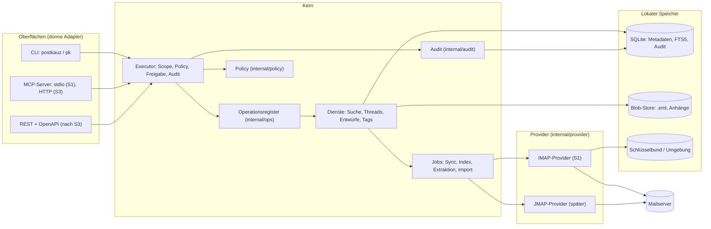

# Architektur

Stand: S1.11 (16.10.2026, Schnitt 1 komplett; neu: `internal/crash`, `internal/secretscan`, Audit-Export mit Kette). Dieses Dokument beschreibt die Zielarchitektur der Schnitte S1–S3 und markiert, was das Gerüst schon enthält. Verbindlich sind die Entscheidungen in [entscheidungen.md](entscheidungen.md); wo dieses Dokument davon abweicht, gilt entscheidungen.md.

„PostKauz" ist ein Arbeitstitel. Alle Namen stehen in `internal/brand` (siehe unten, „Namen").

## 1. Ziel in einem Absatz

Ein lokal laufender E-Mail-Client **ohne GUI**, der ein vorhandenes IMAP-Postfach spiegelt, durchsuchbar macht und Menschen (CLI) sowie KI-Agenten (MCP) bedient. Agenten bekommen Scopes, Risikostufen, Trockenlauf, Freigaben und ein Audit-Log. Der MVP ist **draft-only**: Er schreibt Entwürfe in den Entwürfe-Ordner des Postfachs, versendet aber nie selbst (ADR-002).

## 2. Komponenten



In Textform: Drei Oberflächen rufen **ausschließlich** den Executor. Der Executor schlägt die Operation im Register nach, prüft Scope und Policy, schreibt den Audit-Eintrag und ruft erst dann den Handler. Handler arbeiten gegen den lokalen Speicher; alles, was den Server berührt, läuft über Jobs und das Provider-Interface.

### Paketübersicht

| Paket | Aufgabe | Stand im Gerüst |
|---|---|---|
| `cmd/postkauz` | `main`, ruft `cli.Run` | fertig |
| `internal/brand` | Name, Alias, Präfixe an einer Stelle | fertig |
| `internal/ops` | Register, Executor (Schwärzung je Operation, Fortschrittsmeldungen, Prüfung der Eingabe gegen das `InputSchema`, Audit-ID im Ergebnis), `accounts.list/add/test/remove/set` (`accounts.set` seit S2.0, nur für Menschen), `sync.run`, `mailboxes.list`, `messages.get`, `messages.search`, `threads.get`, `attachments.list`, `attachments.text`, `keys.create/list/revoke` und Anmeldung per Schlüssel, `audit.list/export/verify` (Export seit S1.11 mit Hash-Kette und Manifest), `policy.get`, `import.run`; Untrusted-Hülle und Budgets in Ausgaben mit Mailinhalt; Panics im Handler abgefangen (S1.11) | S1.11 + Tests |
| `internal/crash` | Panic bereinigt melden: Laufzeitmeldung oder Typ des Panic-Werts (nie dessen Inhalt), Stack nur mit Funktion und Datei:Zeile; genutzt vom Executor (Panic im Handler) und der CLI (Hauptablauf). Seit S2.0 `crash.Go(name, fn)` für eigene Hilfsgoroutinen und `crash.Do(name, fn)` für Arbeitsschritte: `recover`, Bericht ins Log (`crash.SetLogger`), Rückgabe `*crash.PanicError` (`errors.Is(err, crash.ErrInternal)`, derselbe Wert wie `ops.ErrInternal`) | S1.11/S2.0 + Tests |
| `internal/secretscan` | Geheimnisse dort suchen, wo sie nie stehen dürfen (Werte und Schlüsselmuster, ohne sie auszugeben), Dateirechte prüfen; Grundlage von `doctor --secrets` | S1.11 + Tests |
| `internal/policy` | Scope (dazu Pseudo-Scope `any`), Rollen, Risiko R0–R3, `Check` | Stub + Tests |
| `internal/audit` | Event-Typ, Writer-Schnittstelle | Typ + Stubs (SQLite-Writer im Store) |
| `internal/store` | Migrationen mit Schema-Schutz und Snapshot (`VACUUM INTO`), Konten, SQLite-Audit-Writer, Spiegel (Ordner, Nachrichten, Zuordnungen, Fenster als Transaktion), Threads, Texte, Anhänge, Index-Warteschlange und Suche (FTS5), Jobs | S1.7 + Tests |
| `internal/config` | TOML-Konfiguration, Pfade (Konfiguration, Daten, Datenbank, Log) | S1.1 + Tests |
| `internal/secrets` | Schlüsselbund (go-keyring), Umgebung, unsicherer Testspeicher, `Secret`-Typ | S1.1 + Tests |
| `internal/imapx` | dünne Schicht über go-imap (ADR-007, v2.0.0-beta.8 gepinnt): Dial mit Watchdog (misst Schweigen, Rückrufe ausgenommen, plus Obergrenze je Kommando; ADR-007 Nachtrag 1) und TCP-Keepalive, `Session` mit Reconnect und Backoff, Login, SASL-OAuth (Entwurf), CAPABILITY, LIST mit SPECIAL-USE/LIST-STATUS, CREATE, NOOP, EXAMINE/SELECT (CONDSTORE), UID SEARCH (ESEARCH), FETCH (Metadaten, Flags mit CHANGEDSINCE, Rohmail gestreamt), STATUS, APPEND, STORE (nur Testwerkzeuge/S3, kein `\Deleted`), IDLE mit eigenem Neustart | S1.5 + Tests |
| `internal/oauth` | Token-Quelle mit Refresh und Sperrzeit (Entwurf P3) | Entwurf + Tests |
| `internal/blob` | Blob-Store: atomar, SHA-256, optional zstd, Größenlimit | S1.2 + Tests |
| `internal/mimeparse` | MIME-Parser auf `go-message` mit Charset-Reader: Kopf, Adressen, tolerantes Datum (Zone ohne Vorzeichen, Ersatz `INTERNALDATE`), Text/HTML, Anhänge mit SHA-256 und Rückruf für den dekodierten Inhalt (`OnAttachment`); Limits für Kopf, Teile, Tiefe, Teilgröße; entpackt nie Archive | S1.2/S1.6 + Korpus-Test |
| `internal/sanitize` | Body-Bereinigung: HTML → Text mit Allowlist, versteckter Text erkennen und entfernen, Links sichtbar mit Warnungen, unsichtbare Formatzeichen entfernen, Quote-Stripper; seit S2.2 `CleanHTML`: HTML → HTML mit Allowlist für ausgehende Nachrichten (keine Skripte, Stile, Formulare, Objekte, Ereignis-Attribute; Links nur `https:`/`mailto:`, Bilder nur `cid:`, Stilangaben ohne Remote-Inhalt) | S1.6/S2.2 + Korpus-Test, Fuzz-Test |
| `internal/magic` | Typ eines Anhangs aus Magic Bytes (ZIP-Formate nur über Eintragsnamen, nie entpackt), Vergleich mit Content-Type und Endung, ausführbare Typen | S1.6 + Korpus-Test |
| `internal/extract` | Textextraktion: PDF über `pdftotext`, DOCX im eigenen Kindprozess, Text/HTML/Mail im Prozess; Zeit-, Ein-/Ausgabe- und Speichergrenzen, knappe Umgebung | S1.6 + Tests (hängender Fake-Extraktor) |
| `internal/search` | Volltextsuche ohne Datenbankzugriff: Normalisierer (`Fold`: Diakritika, ß→ss, ae/oe/ue), deutscher Stemmer (Snowball über `blevesearch/snowballstem`), Index-Spalten je Nachricht, Abfragesprache (Parser, Übersetzung in FTS5-Ausdrücke und Filter), Cursor | S1.7 + Tests |
| `internal/jobs` | Warteschlange abarbeiten (Tabelle `jobs`): `extract` (Anhangstext im Subprozess, Zeitbudget je Lauf) und `index` (Volltextindex in Transaktionen); Sperre mit Ablauf, Übernahme nach Abbruch, Wiederholung nach Fehlern | S1.7 + Tests |
| `internal/thread` | Threading: Zuordnung über Message-ID/In-Reply-To/References (vereinigt Threads), Rückfall normalisierter Betreff im 30-Tage-Fenster für Antworten ohne Verweise; Index im Speicher und in SQLite (`internal/store`) | S1.6 + Korpus-Test |
| `internal/compose` | Nachrichtenbau aus einem Entwurf (S2.2, A02 E3/E10/E11), rein (keine Datenbank, kein Server): eigener Eingabetyp `compose.Input` (Art `new`/`reply`/`reply_all`/`forward`, Identität, Empfänger, Betreff, `BodyMarkdown` oder `BodyHTML`, Schalter Zitat/Signatur/Anhänge, Ausgangsnachricht `compose.Original` aus `mimeparse.Message`, Anhänge als Blob-Bytes oder Datei unter `AttachDir`, Grenzen, injizierbare Uhr und Zufall), Ergebnis `compose.Message` mit Rohnachricht, Kopffeldern, `BodyText`/`BodyHTML`, Anhängen mit SHA-256 und Hinweisen; Ablehnungen als `*compose.Error` mit festem Grund (`invalid_input`, `invalid_address`, `too_many_recipients`, `too_large`, `hidden_text_in_draft`, `attach_outside_dir`, `attach_not_found`), die S2.3 als `denied` weiterreicht. Kopfzeilen mit go-message (Message-ID `pk.<20 Hex>@<Domain>`, In-Reply-To/References gekürzt auf 20, Betreffpräfix, „Allen antworten" ohne eigene Adressen, RFC 2047, kein `X-Mailer`), Markdown über goldmark (nur harte Zeilenumbrüche), HTML über `sanitize.CleanHTML`, versteckter Text → Ablehnung, `text/plain` aus dem HTML, Zitat und Weiterleitung aus dem bereinigten Text der Ausgangsnachricht, `multipart/alternative` bzw. `mixed`, Anhangstyp per `internal/magic`, Dateien über `os.Root`. Abbildung eines Entwurfs: Paketkommentar | S2.2 + Korpus-Test (Antwort und „Allen antworten" auf jede Korpus-Nachricht, Parser und Threads), Golden-Test |
| `internal/corpus` | Generator des synthetischen Testkorpus mit Manifest (`make corpus`); `imapload` und `cmd/corpusload` legen ihn per APPEND in einem lokalen Testserver ab (`make corpus-load`) | S1.2/S1.4 + Tests |
| `internal/provider` | `MailProvider`, `Submission` | Schnittstellen |
| `internal/provider/imap` | IMAP-Provider über `imapx`: `Connect`, Fähigkeiten, Strategie, `ListMailboxes` mit Rollen (SPECIAL-USE, Namen, Gmail-Namen) und Zustand, `Changes` (Fenster, CONDSTORE bzw. UID-Scan, UID-SEARCH-Abgleich), `FetchHeaders`, `FetchRaw`, `Idle` (eigene Verbindung); Verbindungsprüfung für `account test` | S1.5 + Tests, Integrationstest (Docker) |
| `internal/mailsync` | Sync-Engine gegen eine schmale Provider-Schnittstelle: Ordnerabgleich, Fenster, Abgleich per Message-ID/Größe bzw. `content_hash`, Blob-Store, Parser, Aufbereitung (Text, Links, versteckter Text, Anhänge mit Typprüfung), Threads, Transaktion je Fenster; Nachziehen älterer Bestände; am Ende jedes Laufs die Jobs des Kontos (`internal/jobs`: Extraktion, Suchindex); `Watch` (IDLE + Intervall); `Runner` für `sync.run` | S1.7 + Tests, Leck-Tests, Integrationstest (Docker) |
| `internal/importer` | Import aus mbox (Thunderbird `berkeleystore`, mboxrd) und Maildir: Quellen finden (`.sbd`-Unterordner, Maildir++, IMAP-UTF-7-Namen, `.msf` übergehen), streamend lesen (Trennzeilen, `>From`-Quoting, `X-Mozilla-*` lesen und entfernen, Zeilenenden am Schluss vereinheitlichen), Abgleich per Message-ID und `content_hash` mit Varianten, Aufbereitung über `mailsync.Prepare`, Stapel mit Stand je Quelle (`import_sources`), `Runner` für `import.run` (Kontosperre wie der Sync, danach die Jobs des Kontos) | S1.10 + Tests (Thunderbird- und Maildir-Korpus, Überlappung mit gesynctem Konto, `kill -9`, 200 MB), Integrationstest (Dovecot) |
| `internal/cli` | cobra-Adapter, Exit-Codes, `doctor` (seit S1.11 mit `--secrets` und Stand des Audit-Exports), Strg+C- und Panic-Behandlung, globale Optionen (`--json`, `--dry-run`, `-a`, `--key`, `--quiet`, `--profile`, `--explain`) | alle lesenden Kommandos (S1.8): `version`, `doctor`, `accounts list`, `account add/test/remove`, `sync`, `mailbox list`, `show`, `search`, `thread`, `attach list/text`, `key create/list/revoke`, `audit`, `audit export/verify`, `policy show`; Vertragstest Register ↔ CLI |
| `internal/mcp` | MCP-Adapter auf dem offiziellen Go-SDK (v1.8.0): Tabellen für Tools (Operation → Tool, Standardwerte, engere Grenzen), Resources (`mail://…` → Operationen) und Prompts; Scope-Filter je Schlüssel; Bereinigung aller Zeichenketten (Steuer- und Formatzeichen); Fehler als Ergebnis mit Status | S1.9 + Vertragstest Register ↔ MCP, Sitzungs- und stdio-Smoke-Test |

 Der Sync heißt `internal/mailsync` (nicht `internal/sync`, das kollidierte mit dem Standardpaket `sync`).

`make guard` prüft neben „kein SMTP-Code" auch, dass außer `internal/imapx` kein Paket go-imap importiert (ADR-007; Tests dürfen den Fake-Server der Bibliothek nutzen) und dass go-imap auf v2.0.0-beta.8 gepinnt bleibt.

## 3. Zwei Wahrheiten (ADR-003)

Es gibt keine einzelne „Wahrheit". Zwei Datenbestände haben je eigene Zuständigkeit:

| Frage | Wahrheit | Folge |
|---|---|---|
| Was liegt **jetzt** im Postfach, welche Flags, welcher Ordner? | **Der Server** | Bei Konflikt gewinnt der Server (außer bei rein lokalen Tags). |
| Was habe ich je gesehen, was ist archiviert, was ist indiziert, wer hat was freigegeben, was wurde ausgelöst? | **Die lokale Datenbank** | Archiv, Index, Freigaben und Audit hängen nie vom Server ab. |

Konsequenzen, die als Regeln gelten:

1. **Server gewinnt beim Zustand.** Der nächste `Changes()`-Lauf überschreibt lokale Flags und Ordnerzuordnungen. Lokale Schreibaktionen sind „optimistisch mit Pending-Markierung", bis der Server sie bestätigt.
2. **Der Server löscht, das Archiv behält.** Verschwindet eine Nachricht serverseitig, setzt PostKauz `messages.deleted_remote_at` und behält Rohmail und Index. Eine Aufbewahrungs- oder Löschfrist ist eine eigene, ausdrückliche Operation (ab S3, Löschkonzept), nie ein Nebeneffekt des Sync.
3. **Anbieterwechsel synchronisiert das Archiv nie zurück.** Wer das Konto wechselt, legt ein neues Konto an; das alte Archiv bleibt lesbar. Es gibt keine Operation „Archiv in neues Postfach hochladen" (außer dem bewussten Export, S3).
4. **Erstabgleich und Import über Identität, nicht über Datum.** Ein Thunderbird-Import (mbox/Maildir) und der erste IMAP-Abgleich erkennen Duplikate per `Message-ID` und `content_hash`, mit Überlappung; „alles ab Datum X" ist verboten, weil es Lücken und Doppelte erzeugt.
5. **Entwürfe sind lokal-führend bis zum APPEND.** Ein Entwurf entsteht lokal (`drafts`), wird per IMAP APPEND in den Entwürfe-Ordner gelegt und dort vom Menschen weiterbearbeitet oder gesendet. Ab dem Zeitpunkt, an dem der Mensch ihn im Mailclient anfasst, ist die Serverkopie maßgeblich; PostKauz überschreibt sie nicht mehr.

## 4. Provider-Interface: JMAP-Semantik, IMAP-Abbildung

Das Interface (`internal/provider/provider.go`) ist nach JMAP geschnitten, weil JMAP Postfach, Nachricht, Zustand und Änderungen am saubersten beschreibt. IMAP wird darauf abgebildet. Ein späterer JMAP-Provider passt 1:1.

| Methode | JMAP | IMAP (S1) |
|---|---|---|
| `Capabilities()` | Session-Objekt | CAPABILITY nach Login: CONDSTORE, QRESYNC, UIDPLUS, IDLE, MOVE, SPECIAL-USE, NAMESPACE, `X-GM-EXT-1`, PERMANENTFLAGS |
| `ListMailboxes()` | `Mailbox/get` (mit `role`) | `LIST` mit SPECIAL-USE; sonst Namensheuristik je Anbieter; Namen aus IMAP-UTF-7 dekodiert |
| `Changes(mailbox, since, limit)` | `Email/changes` mit `sinceState` | siehe unten |
| `FetchHeaders()` | `Email/get` (Kopf) | `UID FETCH (UID FLAGS INTERNALDATE RFC822.SIZE MODSEQ BODY.PEEK[HEADER])`; ganzer Kopf statt `HEADER.FIELDS (MESSAGE-ID)`, weil GreenMail für die von go-imap gequoteten Feldnamen nichts liefert |
| `FetchRaw()` | Blob-Download | `UID FETCH BODY.PEEK[]` für ein Fenster von UIDs (streamt je Nachricht; `.PEEK`, damit `\Seen` unberührt bleibt) |
| `SetFlags()` | `Email/set` (keywords) | `UID STORE`; Keywords nur bei `KeywordsPermanent` |
| `Move()` | `Email/set` (mailboxIds) | `UID MOVE`, sonst `COPY` + `\Deleted`-Markierung ohne Expunge-Aufruf der Agentenseite (siehe Hinweis) |
| `Trash()` | `Email/set` → Papierkorb | `MOVE` in den Ordner mit Rolle `trash`; bei Gmail ausdrücklich „in den Papierkorb verschieben" |
| `Append()` | `Email/import` | `APPEND` mit Flags und Datum; UID über `APPENDUID` (UIDPLUS) |
| `Idle()` | EventSource/Push | `IDLE` auf INBOX; Polling für übrige Ordner |

**Kein Expunge.** Das Interface enthält absichtlich keine Operation, die Nachrichten endgültig löscht (ADR-002, Entscheidung 6). Wo IMAP ohne MOVE-Erweiterung nur `COPY` + `\Deleted` + `EXPUNGE` kennt, ist dieser Ersatz eine interne Angelegenheit des IMAP-Providers und beschränkt sich auf `UID EXPUNGE` der soeben kopierten UIDs (UIDPLUS); ohne UIDPLUS und ohne MOVE meldet der Provider `ErrUnsupported`, statt ein globales `EXPUNGE` auszuführen.

### Änderungserkennung (`Changes`)

Die Strategie folgt den erkannten Fähigkeiten (`Capabilities.SyncStrategy()`). **Hinweis (ADR-007):** `go-imap` v2 beta.8 kennt kein QRESYNC; bis zu einem Beitrag oder Fork läuft auch auf QRESYNC-fähigen Servern die Strategie `condstore` mit UID-SEARCH-Abgleich für Löschungen. Alle IMAP-Zugriffe laufen über `internal/imapx` mit Watchdog (Schweigen höchstens 30 s, Obergrenze 10 min je Kommando, beides konfigurierbar; Close + Reconnect mit Backoff, IDLE-Neustart alle 5 bis 10 Minuten, TCP-Keepalive; ADR-007 Nachtrag 1).


| Strategie | Voraussetzung | Neue | Flag-Änderungen | Gelöschte |
|---|---|---|---|---|
| `qresync` | CONDSTORE + QRESYNC | UIDs ab `UIDNEXT` | `FETCH … (CHANGEDSINCE modseq)` | `VANISHED (EARLIER)` |
| `condstore` | CONDSTORE | UIDs ab `UIDNEXT` | `CHANGEDSINCE` | periodischer `UID SEARCH ALL`-Abgleich |
| `uid-scan` | nichts | UIDs ab `UIDNEXT` | Flags aller UIDs in Fenstern | periodischer `UID SEARCH ALL`-Abgleich |

- **UIDVALIDITY-Wechsel** setzt `ChangeSet.Reset`. Der Aufrufer gleicht dann den Ordner per `Message-ID`/`content_hash` neu ab (Regel 4 oben), er lädt nicht blind alles neu. Umsetzung (S1.5): Die alten Zuordnungen des Ordners werden sofort gelöst (die Nachrichten bleiben, vorübergehend mit `deleted_remote_at`), dann wird der Ordner wie neu in Fenstern abgeglichen; Köpfe mit bekannter Message-ID und gleicher Größe werden nur zugeordnet, ohne den Inhalt erneut zu laden (Test: 0 erneut geladene Inhalte auf Dovecot, Stalwart, GreenMail).
- **Erstsync in Fenstern** (`limit`, `ChangeSet.More`): resume-fähig, der neue `SyncState` wird erst **nach** erfolgreicher lokaler Verarbeitung gespeichert. Ein Absturz mitten im Fenster wiederholt das Fenster; Idempotenz entsteht über den eindeutigen Schlüssel `(mailbox_id, uid)` und `content_hash`.

**Umsetzung im Detail (S1.4/S1.5, `internal/provider/imap/sync.go`, `internal/mailsync`):**

1. `Changes` wählt den Ordner per `EXAMINE` (mit `CONDSTORE`, wo vorhanden; der Sync ändert am Server nichts).
2. **Cursor** ist `mailboxes.uidnext`: Alle UIDs darunter sind gespiegelt. Neue UIDs ermittelt `UID SEARCH UID n:*` (die RFC-Eigenheit, dass `n:*` immer die höchste UID liefert, wird gefiltert). Ein Fenster umfasst höchstens `limit` UIDs; der Cursor steht dann hinter dem Fenster (`More`), die Phase des Ordners ist `initial`.
3. **Löschabgleich bei Bedarf und regelmäßig:** Stimmt `EXISTS` mit „lokal bekannt + neu" überein, ist meist nichts gelöscht worden. Das gilt nicht, wenn lokal zugleich eine Nachricht fehlt, die der Server führt (z. B. ein Fehler beim Spiegeln): Dann verdeckt sie eine Löschung. `sync --watch` gleicht deshalb seit S2.0 zusätzlich alle `--full-check-interval` (Standard 1 h, erster Lauf eingeschlossen; scheitert dabei ein Ordner, wiederholt der nächste Lauf den vollen Abgleich) die UID-Listen aller Ordner voll ab (`ChangesOptions.CheckDeleted`, frisch vom Server, ohne den vollen Flag-Abgleich); der einmalige `sync` nicht. Sonst (und beim Erstabgleich, Reset, `--full`) folgt `UID SEARCH ALL` (mit `ESEARCH` als Bereiche); das Ergebnis (`Present`) bleibt für die weiteren Fenster desselben Laufs zwischengespeichert, solange UIDVALIDITY, UIDNEXT und EXISTS gleich bleiben. Der Aufrufer leitet daraus Löschungen (lokal, nicht mehr vorhanden) und Fehlendes (vorhanden, unterhalb des Cursors, lokal unbekannt; z. B. frühere Fehler) ab.
4. **Flags erst im letzten Fenster:** mit CONDSTORE per `UID FETCH 1:* (FLAGS) (CHANGEDSINCE m)`; `m` ist im Erstsync der Stand vor dem ersten Fenster (Untergrenze), damit Änderungen während des Erstsyncs nicht verloren gehen. Ohne CONDSTORE (Strategie `uid-scan`) werden die Flags aller bekannten UIDs verglichen; nur echte Änderungen zählen.
5. Die Engine holt für neue UIDs zuerst den **Kopf**. Gibt es die Nachricht im Konto schon (gleiche Message-ID und Größe, in diesem Ordner noch nicht zugeordnet: Kopie, Gmail-Label, verschobene Nachricht, Reset), wird sie nur zugeordnet. Sonst wird die Rohmail gestreamt (je FETCH höchstens 16 MiB angekündigte Größe, wegen der Obergrenze je Kommando), in den Blob-Store geschrieben, aus der Datei geparst und über `content_hash` (SHA-256 ohne CR-Bytes) noch einmal gegen Vorhandenes geprüft.
6. Ein Fenster wird in **einer Transaktion** geschrieben (Nachrichten, Texte, Zuordnungen, Flag-Änderungen, Löschungen, Zustand); Fenster mit mehr als 32 MiB Inhalt werden in mehrere Transaktionen geteilt, der Cursor wandert erst mit der letzten.
7. Fehler einzelner Nachrichten (z. B. leerer Inhalt vom Server) zählen als `errors`; der Cursor läuft weiter, der nächste Lauf holt sie über Punkt 3 nach. **Größenlimit** `[imap] max_message_bytes` (S2.0): Die Engine vergleicht vor dem Abruf des Inhalts die Größe aus den Köpfen (`RFC822.SIZE`); eine größere Nachricht wird nicht angefordert (sonst überträgt der Server sie ganz), zählt einmal als Fehler und steht in `skipped_messages` (Migration 0009). Folgende Läufe fordern sie nicht erneut an und zählen sie beim Zahlenvergleich (Punkt 3) als bekannt; der Löschabgleich entfernt den Eintrag, wenn der Server sie nicht mehr führt; `sync --full` leert die Liste des Ordners und prüft erneut (etwa nach einer höheren Grenze). Die Lese-Grenze im Abruf (`internal/imapx`, `cappedReader`) bleibt als zweite Sicherung, falls der Server eine zu kleine Größe angibt. Fehler eines Ordners überspringen den Ordner; Verbindungs- und Anmeldefehler sowie Abbruch beenden den Lauf.
- **Reconnect mit Backoff** (exponentiell, mit Obergrenze und Jitter). `ErrAuth` wird **nicht** wiederholt: ein Audit-Ereignis und ein Hinweis in `doctor`, sonst sperren Anbieter das Konto.
- **Gmail-Eigenheiten** (`GmailExtensions`): Der Ordner „Alle Nachrichten" enthält jede Nachricht ein weiteres Mal. PostKauz behandelt Labels als Ordner und dedupliziert über `Message-ID`; eine Nachricht darf in `message_mailboxes` mehrfach vorkommen, in `messages` nur einmal. Verbindungslimit (15 je Konto) beachten: ein Pool von höchstens 3–4 Verbindungen.

### Versand (`Submission`)

`internal/provider/submission.go` beschreibt den Versandweg (SMTP, später JMAP `EmailSubmission`) und trägt die Eigenschaft `SavesSentCopy()` (Gmail legt die Kopie selbst an, Dovecot nicht). Es ist im MVP **nicht implementiert und nicht verdrahtet** (ab S4).

## 5. Operationsregister und Adapter (ADR-004)

Jede fachliche Operation ist ein Eintrag **als Daten** in `internal/ops`:

```go
type Operation struct {
    Name         string       // "objekt.verb", z. B. "messages.search"
    Scope        policy.Scope // z. B. mail:search
    Risk         policy.Risk  // R0–R3
    Idempotent   bool
    InputSchema  json.RawMessage // JSON-Schema
    OutputSchema json.RawMessage
    Summary      string       // ein Satz für Hilfe und Tool-Beschreibung
    Handler      Handler
}
```

Die Oberflächen sind **dünne, ausdrücklich geschriebene Adapter** mit je einer Bindungstabelle. Es gibt keine Reflection und keinen Generator:

| Operation | CLI | MCP-Tool | REST (später) |
|---|---|---|---|
| `accounts.list` | `postkauz accounts list` | `mail_list_accounts` | `POST /v1/ops/accounts.list` |
| `messages.search` | `postkauz search` | `mail_search` | `POST /v1/ops/messages.search` |
| `drafts.create` | `postkauz draft new` / `draft reply` | `mail_create_draft` | `POST /v1/ops/drafts.create` |

Namen, Hilfetexte, Ausgabeformate und die Auswahl, was MCP überhaupt anbietet, sind Entscheidungen und stehen deshalb von Hand in den Bindungstabellen. Was der Adapter **nicht** tut: Scope prüfen, Policy auswerten, auditieren, Fachlogik. Das tut allein der Executor.

**Vertragstests** (je Operation, ab der zweiten Operation Pflicht):

1. Die Operation ist formal gültig (`Validate`: Name, Scope, Risiko, Schemas, Handler).
2. Jede Oberfläche, die sie bindet, liefert dasselbe Ein-/Ausgabeschema wie das Register.
3. Die Operation durchläuft für jeden Scope-Satz die Kette Scope → Policy → Freigabe → Audit → Handler (verweigerte Aufrufe erreichen den Handler nie und sind auditiert).
4. Der Executor ist **fail closed**: Schlägt das Schreiben des Audit-Eintrags fehl, läuft der Handler nicht (Test vorhanden).

Umsetzung von 1, 3 und 4 (S1.5): Alle Operationen stehen in **einer** ausdrücklich geschriebenen Liste, `ops.Catalog` (`internal/ops/catalog.go`); CLI und später MCP registrieren sie über `ops.NewDefaultRegistry`. `TestContractEveryOperationRoleAndDryRun` (`internal/ops/ops_test.go`) schickt jede Katalog-Operation mit jeder Rolle aus `policy.Roles` (dazu „ohne Scopes") und fünf Trockenlauf-Varianten (Standard, `--dry-run`, `dry_run=false`, Schlüssel-Standard an, Schlüssel-Standard an mit `dry_run=false`) durch den Executor und prüft: Entscheidung wie in `docs/sicherheit.md` (unabhängig von `policy.Check` formuliert), genau ein Audit-Eintrag ohne Geheimnis, Handler nur bei Erlaubnis, **Trockenlauf, R0 und Ablehnung verändern weder Datenbank noch Schlüsselbund** (Zustandsvergleich aller Tabellen), eine erlaubte schreibende Operation wirkt, die Ausgabe trägt die Pflichtfelder ihres `OutputSchema` und `dry_run` wie entschieden. `TestContractEveryOperationFailsClosed` prüft 4 je Operation. Eine neue Operation braucht eine Zeile mit gültiger Beispiel-Eingabe in `contractInputs`, sonst scheitert der Test. Punkt 2 für die CLI (S1.8): `TestBindingsCoverCatalogAndSchemas` (jede Operation hat genau ein Kommando; die Felder, die ein Kommando setzen kann, sind genau die Eigenschaften des `InputSchema`) und `TestCLIContractRegistry` (je Kommando echte Aufrufe; jede gebaute Eingabe gegen das `InputSchema`, jede `--json`-Ausgabe gegen das `OutputSchema`, jedes Feld mindestens einmal gesetzt). Für MCP (S1.9): `TestEveryOperationIsBoundOrExcluded` (jede Operation hat ein Tool oder einen Grund in `notOverMCP`) und `TestToolSchemasMatchRegistry` (Ein- und Ausgabeschema wie im Register; nur dokumentierte engere Zahlengrenzen, die der Executor über `Request.Narrow` ebenfalls prüft).

## 6. Policy- und Audit-Kette

```mermaid
sequenceDiagram
  participant O as Oberfläche (CLI/MCP)
  participant X as Executor
  participant P as Policy
  participant A as Audit
  participant H as Handler
  O->>X: Request(Key, Operation, Input, DryRun?)
  X->>X: Register: Operation nachschlagen
  X->>P: Check(Key, Operation, DryRun)
  P-->>X: Decision (allow, deny, needs_approval; DryRun)
  X->>A: Append(Event: Ergebnis der Prüfung)
  alt allow
    X->>H: Handler(Input, DryRun)
    H-->>X: Output oder Fehler
    opt Fehler
      X->>A: Append(Event: error)
    end
    X-->>O: Result
  else deny oder needs_approval
    X-->>O: PolicyError (Exit 3 bzw. 4, MCP-Status)
  end
```

- **Reihenfolge:** Policy-Entscheid → Audit-Eintrag → Prüfung der Eingabe gegen das `InputSchema` (seit S1.8) → Handler. Der Audit-Eintrag steht **vor** der Wirkung. Fehler im Handler oder eine ungültige Eingabe erzeugen einen zweiten Eintrag (`error`, Grund `handler_error` bzw. `invalid_input`). Das Ergebnis trägt die ID des Audit-Eintrags (CLI `--explain`).
- **Trockenlauf:** `dry_run` gilt für jede schreibende Operation. Standard je Schlüssel (`dry_run_default`), ausdrücklich überschreibbar. Der Handler bekommt `Call.DryRun` und darf dann nichts verändern.
- **`needs_approval` ist kein Fehler der Operation**, sondern ein Zustand: MCP liefert ihn als Ergebnis (nicht als `isError`), die CLI als Exit-Code 4.
- **Freigabe-Erzwingung liegt im Executor**, nicht in einer Oberfläche. Ein zweiter MCP-Server oder später REST kann sie nicht umgehen.

Stand im Gerüst: `policy.Check` ist ein Stub mit den Regeln „fehlender Scope → Deny, R0/R1 → Allow, R2 → Allow, R3 → NeedsApproval, Trockenlauf → Allow mit `DryRun`". Policy-Datei, Limits und die Freigabe-Zustandsmaschine kommen mit S2 (siehe [sicherheit.md](sicherheit.md)).

## 7. Jobs und Prozessmodell

Alles, was den Server berührt oder lange dauert, läuft als **Job** (Tabelle `jobs`, kein Redis, kein externer Broker):

| Job-Typ | Auslöser | Inhalt |
|---|---|---|
| `sync` | Intervall, IDLE-Signal, `postkauz sync`, `mail_sync_now` | `Changes()` eines Ordners, Köpfe und Rohmails holen, Blobs schreiben |
| `index` | Trigger, sobald eine Nachricht, ihr Text oder ein Anhang entsteht oder sich ändert (`index_queue`) | FTS-Zeilen beider Tabellen schreiben, 200 Nachrichten je Transaktion, bis die Warteschlange leer ist (seit S1.7; die Body-Bereinigung macht seit S1.6 der Sync beim Speichern) |
| `extract` | Trigger, sobald ein Anhang auf Extraktion wartet | Anhangstext in Subprozess mit Zeit- und Speicherlimit; Zeitbudget 60 s je Lauf, mindestens ein Anhang, Rest im nächsten Lauf (seit S1.7 über die Tabelle `jobs`; S1.6: am Ende des Syncs ohne Tabelle) |
| `import` | `postkauz import mbox/maildir` | Einlesen mit Message-ID-/Hash-Abgleich. Seit S1.10 läuft der Import im Vordergrund ohne Eintrag in `jobs` (wie `sync`): Er sperrt das Konto, speichert je Stapel den Stand der Quelle (`import_sources`) und führt am Ende die Jobs `extract` und `index` des Kontos aus |
| `export` | `postkauz export`, täglich (Audit) | mbox/EML-Verzeichnis, Audit-JSONL mit Prüfsumme |

Regeln: Jobs sind **idempotent** und wiederholbar; Sperren über `locked_by`/`locked_at` mit Ablauf; `attempts` und `last_error` für Backoff; ein Job je (Konto, Ordner) gleichzeitig.

Umsetzung S1.7 (`internal/jobs`, `internal/store/jobs.go`): Ein Job gilt einem Konto und einer Art (`extract`, `index`), höchstens einer ist offen. Der Sync führt am Ende jedes Laufs (auch je Runde von `sync --watch`) die fälligen Jobs seines Kontos aus: zuerst die Extraktion, dann den Index, damit extrahierter Text im selben Lauf durchsuchbar wird; vorher baut er den Index neu auf, wenn sich `search.FTSVersion` geändert hat. Die Sperre gilt 2 Minuten und wird nach jedem Schritt erneuert; weil der Sync die Kontosperre hält, übernimmt er einen „laufenden" Job seines Kontos sofort (Abbruch per `kill -9` setzt ohne Wartezeit fort). Fehler des Jobs (nicht einzelner Anhänge) werden mit Wartezeit 1, 2, 4 … Minuten (höchstens 1 h) wiederholt, nach 5 Fehlern ist der Job `failed`; neue Arbeit legt dann einen neuen Job an. Strg+C gibt laufende Jobs zurück. Kurzlebige Prozesse (`search`, später MCP) führen keine Jobs aus; `search` meldet, wie viele Nachrichten noch auf den Index warten.

**Panics in Hilfsgoroutinen und Arbeitsschritten (seit S2.0, A02 A5):** Der Executor fängt Panics im Handler, die CLI im Hauptablauf (S1.11). Eine eigene Goroutine fängt das nicht; ihr Panic beendete den Prozess mit der Standardausgabe von Go (Panic-Wert, Stack mit Argumenten). Deshalb startet jede eigene Hilfsgoroutine über `crash.Go(name, fn)`; der Kanal liefert genau einen Wert (nil, Fehler von `fn` oder `*crash.PanicError`), den der Starter auswertet. Eingesetzt für den IDLE-Watcher (`Watch` endet mit dem Fehler), den Watchdog je IMAP-Kommando (schließt bei einem Panic die Verbindung, `guard` meldet den Fehler) und die parallelen FTS-Abfragen der Suche. Arbeitsschritte, die im Handler laufen, fasst `crash.Do(name, fn)` ein, damit der Bericht ihren Namen trägt und die Folge passt: ein Ordner des Syncs (`sync mailbox`, mit allen Fenstern; der Lauf endet mit Fehler statt den Ordner zu überspringen), eine Quelle des Imports (`import source`, mit ihren Stapeln; gespeicherte Stapel bleiben), die Extraktion im Prozess (`extractor`; nur dieser Anhang scheitert) und der Extraktor-Kindprozess (bereinigte Meldung, Exit 2, statt `panic: <Wert>` als erste Zeile, die der Elternprozess als Grund speichert). Ein `*crash.PanicError` zählt im Executor wie ein Panic im Handler (Audit-Grund `panic`, Code `internal`). Auch der Aufruf der Schlüsselbund-Bibliothek mit Zeitgrenze (`internal/secrets`, `Keyring.call`) startet über `crash.Go`; `mapErr` reicht einen `*crash.PanicError` unverändert durch. Nicht abgedeckt: Goroutinen von Bibliotheken (go-imap, MCP-SDK, `os/exec`).

Prozesse im MVP:

- `postkauz sync --watch` (S1.5): Dauerläufer im Vordergrund. Er synct sofort, danach alle 5 Minuten (`--interval`; seit S2.0 stündlich mit vollem UID-Abgleich aller Ordner, `--full-check-interval`) und bei jeder IDLE-Meldung der INBOX (eigene Verbindung, IDLE-Neustart alle 5 bis 10 Minuten, Standard 8; ein Blackhole fällt beim Neustart am unbeantworteten `DONE` auf). Verbindungsfehler eines Laufs beenden ihn nicht (nächster Lauf, IDLE nach 30 s neu), ein Anmeldefehler schon. Nach jedem Lauf arbeitet er die Jobs seines Kontos ab (Extraktion, Index; seit S1.7). Später als Windows-Aufgabe, systemd-Dienst oder Docker-Container.
- `postkauz mcp` (S1.9 ✓): kurzlebiger stdio-Prozess je Agent-Sitzung, **ohne** eigenen Sync; er liest die Datenbank (und soll später Jobs einreihen, z. B. `mail_sync_now`; noch offen). Der Schlüssel kommt aus `POSTKAUZ_KEY`; jeder Tool-Aufruf läuft mit Akteur `agent` durch den Executor.
- `postkauz …` (CLI): kurzlebig.

Alle Prozesse teilen **eine SQLite-Datei** im WAL-Modus mit `busy_timeout` (5 s); schreibende Transaktionen beginnen mit `BEGIN IMMEDIATE` (`_txlock=immediate`), damit ein zweiter Schreiber wartet, statt mit `SQLITE_BUSY` abzubrechen (getestet). Zwei schreibende Syncs **desselben Kontos** schließt eine Dateisperre je Konto aus (`sync-<id>.lock`, flock bzw. `LockFileEx`); der zweite endet mit `sync_running`. Seit S1.10 nimmt der Import dieselbe Sperre (ein Import neben `sync --watch` desselben Kontos könnte sonst dieselbe Nachricht gleichzeitig neu anlegen). Es gibt genau einen schreibenden Dauerläufer je Datenbank; die kurzlebigen Prozesse schreiben nur kurze Transaktionen (Audit, Entwürfe, Job-Einreihung). Die Datenbank darf nie in einem Cloud-synchronisierten Ordner liegen (siehe [datenmodell.md](datenmodell.md)).

## 8. Namen (Arbeitstitel)

Der Projektname ist ein Platzhalter. Umbenennen heißt: `internal/brand/brand.go`, Modulpfad in `go.mod` samt Importen (`go mod edit -module …` plus `sed`), `BINARY`/`ALIAS` im Makefile und Verzeichnis `cmd/postkauz`. Doku und Meldungen leiten sich aus `brand` ab, soweit es der Aufwand rechtfertigt; die Doku nennt „PostKauz" im Text und wird bei einer Umbenennung per Suchen/Ersetzen angepasst.
