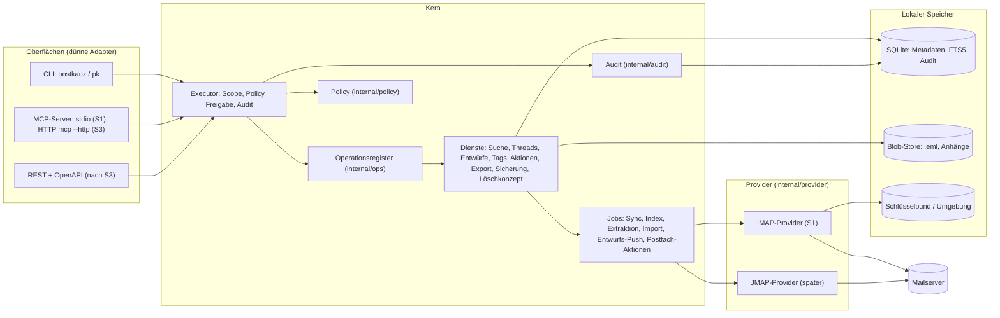

# Architektur

Stand: S3.8 (29.10.2026, Schnitt 3 komplett, Release-Kandidat 0.3.0-rc1; neu in Schnitt 3: `internal/actions`, `internal/tags`, `internal/export`, `internal/backup`, `internal/retention`, `internal/httpmcp`, `internal/oauth`, `internal/procguard`, `internal/flock`, Job `mailbox_action`, `sync --watch --all`, `mcp --http`, ADR-010; bis S2.9: Schnitt 2 komplett, Abschnitte 6 und 7 und die Paketübersicht gegen den Code geprüft, `internal/drafts`, `internal/compose`, `internal/hook`, Job `draft_push`, ADR-009). Dieses Dokument beschreibt die Zielarchitektur der Schnitte S1–S3 und markiert, was das Gerüst schon enthält. Verbindlich sind die Entscheidungen in [entscheidungen.md](entscheidungen.md); wo dieses Dokument davon abweicht, gilt entscheidungen.md.

„PostKauz" ist ein Arbeitstitel. Alle Namen stehen in `internal/brand` (siehe unten, „Namen").

## 1. Ziel in einem Absatz

Ein lokal laufender E-Mail-Client **ohne GUI**, der ein vorhandenes IMAP-Postfach spiegelt, durchsuchbar macht und Menschen (CLI) sowie KI-Agenten (MCP) bedient. Agenten bekommen Scopes, Risikostufen, Trockenlauf, Freigaben und ein Audit-Log. Der MVP ist **draft-only**: Er schreibt Entwürfe in den Entwürfe-Ordner des Postfachs, versendet aber nie selbst (ADR-002).

## 2. Komponenten



In Textform: Drei Oberflächen rufen **ausschließlich** den Executor. Der Executor schlägt die Operation im Register nach, prüft Scope, Policy, Schlüssel und Eingabe, schreibt den Start-Eintrag des Audits, ruft erst dann den Handler und schreibt danach den Abschluss-Eintrag (Abschnitt 6); eine Ablehnung ist ein einzelner Eintrag, der Handler läuft dann nicht. R3-Operationen erreichen den Handler nur über eine Freigabe durch einen Menschen. Handler arbeiten gegen den lokalen Speicher; alles, was den Server berührt, läuft über Jobs und das Provider-Interface.

### Paketübersicht

| Paket | Aufgabe | Stand im Gerüst |
|---|---|---|
| `cmd/postkauz` | `main`, ruft `cli.Run` | fertig |
| `internal/brand` | Name, Alias, Präfixe an einer Stelle | fertig |
| `internal/ops` | Register, Executor (Schwärzung je Operation, Fortschrittsmeldungen, Prüfung der Eingabe gegen das `InputSchema`, Audit-ID im Ergebnis), `accounts.list/add/test/remove/set` (`accounts.set` seit S2.0, nur für Menschen: Aliasse, seit S2.1 auch das gespeicherte Passwort), `sync.run`, `mailboxes.list`, `messages.get`, `messages.search`, `threads.get`, `attachments.list`, `attachments.text`, `keys.create/list/revoke` und Anmeldung per Schlüssel, `audit.list/export/verify` (Export seit S1.11 mit Hash-Kette und Manifest), `policy.get`, `import.run`; seit S2.3 `drafts.create/update/get/list/request_ready/approve/reject/abandon/mark_sent`, `approvals.get`, `identities.add/list/set_default/remove`, seit S2.8 `drafts.style`; `DraftPusher` (fachlicher Teil des Jobs `draft_push`, S2.5), `HookChecker` (S2.4), Herkunft der Entwurfstexte (`draftview.go`, S2.8); Untrusted-Hülle und Budgets in Ausgaben mit Mailinhalt; Panics im Handler abgefangen (S1.11); Schlüsselprüfung vor jedem Aufruf (`KeyGuard`) | S2.8 + Tests, Vertragstest |
| `internal/crash` | Panic bereinigt melden: Laufzeitmeldung oder Typ des Panic-Werts (nie dessen Inhalt), Stack nur mit Funktion und Datei:Zeile; genutzt vom Executor (Panic im Handler) und der CLI (Hauptablauf). Seit S2.0 `crash.Go(name, fn)` für eigene Hilfsgoroutinen und `crash.Do(name, fn)` für Arbeitsschritte: `recover`, Bericht ins Log (`crash.SetLogger`), Rückgabe `*crash.PanicError` (`errors.Is(err, crash.ErrInternal)`, derselbe Wert wie `ops.ErrInternal`) | S1.11/S2.0 + Tests |
| `internal/secretscan` | Geheimnisse dort suchen, wo sie nie stehen dürfen (Werte und Schlüsselmuster, ohne sie auszugeben), Dateirechte prüfen; Grundlage von `doctor --secrets` | S1.11 + Tests |
| `internal/policy` | Scope (dazu Pseudo-Scope `any`), Rollen, Risiko R0–R3, `Check` (seit S2.0 mit `HumanOnly` und der Angabe, ob ein Mensch ohne Schlüssel ruft; ADR-009); seit S2.1 die Policy-Datei `policy.toml` (`file.go`: Laden, strenge Prüfung, SHA-256, Dokument für die Tabelle `policies`) | S2.1 + Tests |
| `internal/audit` | Event-Typ, Writer-Schnittstelle | Typ + Stubs (SQLite-Writer im Store) |
| `internal/store` | Migrationen mit Schema-Schutz und Snapshot (`VACUUM INTO`), Konten, SQLite-Audit-Writer, Spiegel (Ordner, Nachrichten, Zuordnungen, Fenster als Transaktion), Threads, Texte, Anhänge, Index-Warteschlange und Suche (FTS5), Jobs; seit S2.1 Entwürfe, Freigaben und Identitäten (`DraftTx`, `OwnAddresses`) | S2.1 + Tests |
| `internal/drafts` | Dienst für Entwürfe (S2.1, A02 E5–E11): Zustandsmaschine der Freigabe (`draft` → `pending_approval` → `ready` → `sent_by_human`, `abandoned`; Tabelle aller erlaubten Übergänge), `preview_hash` über die kanonische Form, Grenzen (200.000 Zeichen, Betreff 500, 50 Empfänger je Feld, `net/mail`), Message-ID `pk.<20 Hex>@<Domain>` mit injizierbarem Zufall, Absender aus der Identität, eigene Adressen, Ablauf der Freigaben (`approval_ttl`) mit Systemereignis im Audit; jede Änderung eine kurze Transaktion (`store.DraftTx`, `BEGIN IMMEDIATE`); seit S2.5 Übernahme-Erkennung (`remote.go`), seit S2.6 Versanderkennung nach jedem Sync (`detect.go`, `sentmatch.go`: Message-ID, Rückfall-Abgleich, Hochwassermarke). Operationen dazu in `internal/ops` (S2.3), Nachrichtenbau in `internal/compose` (S2.2) | S2.1–S2.6 + Tests, Integrationstest (Docker) |
| `internal/config` | TOML-Konfiguration, Pfade (Konfiguration, Daten, Datenbank, Log) | S1.1 + Tests |
| `internal/secrets` | Schlüsselbund (go-keyring), Umgebung, unsicherer Testspeicher, `Secret`-Typ; `Denied` für Prozesse ohne Zugangsdaten (MCP über stdio und HTTP) | S1.1 + Tests, `Denied` seit der Nachbesserung T5 |
| `internal/procguard` | Jeden PostKauz-Prozess unter Linux als erste Anweisung von `main` gegen das Auslesen durch denselben Nutzer sperren (`PR_SET_DUMPABLE=0`: kein `/proc/<pid>/environ`, kein ptrace, kein Core-Dump); sonst ohne Wirkung | Nachbesserung T5 (zweite: für alle Kommandos) + Test |
| `internal/imapx` | dünne Schicht über go-imap (ADR-007, v2.0.0-beta.8 gepinnt): Dial mit Watchdog (misst Schweigen, Rückrufe ausgenommen, plus Obergrenze je Kommando; ADR-007 Nachtrag 1) und TCP-Keepalive, `Session` mit Reconnect und Backoff, Login, SASL-OAuth (OAUTHBEARER, XOAUTH2; seit S3.7 im Einsatz), CAPABILITY, LIST mit SPECIAL-USE/LIST-STATUS, CREATE, NOOP, EXAMINE/SELECT (CONDSTORE), UID SEARCH (ESEARCH), FETCH (Metadaten, Flags mit CHANGEDSINCE, Rohmail gestreamt), STATUS, APPEND (seit S2.5 `AppendInfo` mit UIDVALIDITY aus APPENDUID), `UID SEARCH HEADER` (`SearchHeader`, S2.5), STORE (nur Testwerkzeuge/S3, kein `\Deleted`), IDLE mit eigenem Neustart; seit T1a: UID-Sets nur über `uidSet` (UID 0 = „*“, 4294967295, leere Liste und UIDVALIDITY 0 werden vor dem Senden abgewiesen, `ErrInvalidUID`), empfangene UID-Sets bereichsweise mit Obergrenze (kein Bereich bis 4294967295, höchstens EXISTS UIDs und unabhängig davon höchstens `MaxReceivedUIDs` = 10 Millionen, aufgelöst nur ab der gesuchten UID; W2), `Session.Do` wiederholt nur Lesendes oder zugesichert Idempotentes, `Session.DoOnce` für Schreibbefehle; Köpfe in `FetchMeta` gestreamt und begrenzt (1 MiB je Kopf, 16 MiB je FETCH; A12.4; passt ein Kopf nicht mehr ins Budget, bricht der FETCH samt Verbindung ab, `ErrHeaderBudget`, und der Provider holt den Rest auf neuer Verbindung, K3) | S1.5 + Tests, S2.5, T1a |
| `internal/oauth` | OAuth2 für Microsoft-Postfächer (S3.7, E11): Token-Quelle mit Refresh 2 min vor Ablauf, Sperrzeit und lautem Abbruch, wenn ein erneuertes Token nicht speicherbar ist; Ablage nur des Refresh-Tokens im Schlüsselbund (bei Bedarf in Teilen, gespeichert unter einer Sperrdatei je Konto neben der Datenbank, `internal/flock`); Loopback- und Device-Code-Flow über `golang.org/x/oauth2`; `oauthtest` ist der Fake-AS der Tests. `provider.Credential` reicht Passwort oder Token-Quelle bis zur IMAP-Anmeldung (`imap.ConnectWith`), `ops.Credentials` löst sie je Konto auf | S3.7 + Tests |
| `internal/blob` | Blob-Store: atomar, SHA-256, optional zstd, Größenlimit | S1.2 + Tests |
| `internal/flock` | Dateisperren des Betriebssystems ohne Warten (flock bzw. `LockFileEx`), fallen mit dem Prozess: Sperre je Konto (Sync, Import), Prozesssperre neben der Datenbank (geteilt; exklusiv nur zum Migrieren), Sperren für Audit-Export, Blob-GC und das Speichern von OAuth-Token | T1a + Tests |
| `internal/backup` | Sicherung und Wiederherstellung (seit T3, A03 S3.4, E7, A10): Schnappschuss per `VACUUM INTO`, Blob-Kopie inkrementell (inhaltsadressiert, gegen den Namen geprüft), Audit-Archive, `manifest.json` mit SHA-256 je Datei, Tar-Strom; `Restore` prüft das Manifest streng, kopiert mit Prüfung, migriert und macht die Kopie zur eigenen Instanz (`store.PrepareRestored`). Keine eigene Kryptographie | T3 + Tests |
| `internal/mimeparse` | MIME-Parser auf `go-message` mit Charset-Reader: Kopf, Adressen, tolerantes Datum (Zone ohne Vorzeichen, Ersatz `INTERNALDATE`), Text/HTML, Anhänge mit SHA-256 und Rückruf für den dekodierten Inhalt (`OnAttachment`); Limits für Kopf, Teile, Tiefe, Teilgröße; entpackt nie Archive | S1.2/S1.6 + Korpus-Test |
| `internal/sanitize` | Body-Bereinigung: HTML → Text mit Allowlist, versteckter Text erkennen und entfernen, Links sichtbar mit Warnungen, unsichtbare Formatzeichen entfernen, Quote-Stripper; seit S2.2 `CleanHTML`: HTML → HTML mit Allowlist für ausgehende Nachrichten (keine Skripte, Stile, Formulare, Objekte, Ereignis-Attribute; Links nur `https:`/`mailto:`, Bilder nur `cid:`, Stilangaben ohne Remote-Inhalt) | S1.6/S2.2 + Korpus-Test, Fuzz-Test |
| `internal/magic` | Typ eines Anhangs aus Magic Bytes (ZIP-Formate nur über Eintragsnamen, nie entpackt), Vergleich mit Content-Type und Endung, ausführbare Typen; seit T3 (A14) die wirksame Endung `EffectiveExt` (ohne NTFS-Datenstrom, Steuer-/Formatzeichen, Punkte und Leerzeichen am Ende) | S1.6 + Korpus-Test |
| `internal/extract` | Textextraktion: PDF über `pdftotext`, DOCX im eigenen Kindprozess, Text/HTML/Mail im Prozess; Zeit-, Ein-/Ausgabe- und Speichergrenzen, knappe Umgebung | S1.6 + Tests (hängender Fake-Extraktor) |
| `internal/search` | Volltextsuche ohne Datenbankzugriff: Normalisierer (`Fold`: Diakritika, ß→ss, ae/oe/ue), deutscher Stemmer (Snowball über `blevesearch/snowballstem`), Index-Spalten je Nachricht, Abfragesprache (Parser, Übersetzung in FTS5-Ausdrücke und Filter), Cursor | S1.7 + Tests |
| `internal/actions` | Postfach-Aktionen (seit T2, A03 S3.1/S3.2): Ziele aus dem Spiegel auflösen (`store.ServerCopies`, nie Importordner oder Eingaben; je Nachricht eine Quellkopie, sonst `ambiguous_source`), Aktion und Antrag anlegen, Freigabe entscheiden (`service.go`); Ausführung im Prozess mit Zugangsdaten mit Herkunfts- und Kopfprüfung (`runner.go`, Job `mailbox_action`) | T2 + Tests |
| `internal/tags` | Regeln für lokale Tags (seit T2, E5): gültige Namen, Normalisierung, Keyword = Tag-Name | T2 + Tests |
| `internal/retention` | Löschkonzept (seit T3, A03 S3.4, E8): `purge` (Nachrichten, die auf dem Server gelöscht wurden; nie importiertes Archiv, nie Entwurfsbezüge) und `blob gc` (Mark-and-Sweep mit Mindestalter) unter den Sperren aller Konten; Regeln und Zeilen in `store/retention.go`. `audit.rotate` steht wegen der Hash-Kette bei den Audit-Operationen (`internal/ops/auditrotate.go`, Archive in `store/auditarchive.go`) | T3 + Tests |
| `internal/export` | Anhänge sichern und Export (seit T3, A03 S3.3, E6): `SafeFileName` (Dateinamen für Windows, macOS und Linux, Fuzz-Test), `SaveAttachment` (nur unter `export_dir`, über `os.Root`, `O_EXCL`, Zähler, `.blocked`), `Run` (mboxrd in Thunderbird-Ablage bzw. EML-Verzeichnis mit `index.csv`, frisches Ziel). Liest Ordner und Nachrichten über Rückrufe, kennt keine Datenbank | T3 + Rundlauf mit dem Korpus (`internal/cli`) |
| `internal/jobs` | Warteschlange abarbeiten (Tabelle `jobs`): `extract` (Anhangstext im Subprozess, Zeitbudget je Lauf) und `index` (Volltextindex in Transaktionen); seit S2.5 `draft_push` (`RunDraftPush`: Sperre, Erledigung, Rückgabe bei Verbindungsfehlern, Wiederholung mit Wartezeit; die Arbeit macht der Aufrufer mit Verbindung); Sperre mit Ablauf, Übernahme nach Abbruch, Wiederholung nach Fehlern | S1.7 + Tests, S2.5 |
| `internal/mailaddr` | Vergleichsschlüssel für eigene Adressen (`Key`, `Set`): klein; bei `gmail.com`/`googlemail.com` ohne Punkte im lokalen Teil, ohne Zusatz ab `+`, Domain `gmail.com` (Nachbesserung T3, Punkt 15); genutzt von Versanderkennung, „Allen antworten“, Thread-Rückfall und den Aliassen | Nachbesserung T3 + Unit-Test |
| `internal/thread` | Threading: Zuordnung über Message-ID/In-Reply-To/References (vereinigt Threads), Rückfall normalisierter Betreff im 30-Tage-Fenster für Antworten ohne Verweise; Index im Speicher und in SQLite (`internal/store`) | S1.6 + Korpus-Test |
| `internal/compose` | Nachrichtenbau aus einem Entwurf (S2.2, A02 E3/E10/E11), rein (keine Datenbank, kein Server): eigener Eingabetyp `compose.Input` (Art `new`/`reply`/`reply_all`/`forward`, Identität, Empfänger, Betreff, `BodyMarkdown` oder `BodyHTML`, Schalter Zitat/Signatur/Anhänge, Ausgangsnachricht `compose.Original` aus `mimeparse.Message`, Anhänge als Blob-Bytes oder Datei unter `AttachDir`, Grenzen, injizierbare Uhr und Zufall), Ergebnis `compose.Message` mit Rohnachricht, Kopffeldern, `BodyText`/`BodyHTML`, Anhängen mit SHA-256 und Hinweisen; Ablehnungen als `*compose.Error` mit festem Grund (`invalid_input`, `invalid_address`, `too_many_recipients`, `too_large`, `hidden_text_in_draft`, `attach_outside_dir`, `attach_not_found`), die S2.3 als `denied` weiterreicht. Kopfzeilen mit go-message (Message-ID `pk.<20 Hex>@<Domain>`, In-Reply-To/References gekürzt auf 20, Betreffpräfix, „Allen antworten" ohne eigene Adressen, RFC 2047, kein `X-Mailer`), Markdown über goldmark (nur harte Zeilenumbrüche), HTML über `sanitize.CleanHTML`, versteckter Text → Ablehnung, `text/plain` aus dem HTML, Zitat und Weiterleitung aus dem bereinigten Text der Ausgangsnachricht, `multipart/alternative` bzw. `mixed`, Anhangstyp per `internal/magic`, Dateien über `os.Root`. Abbildung eines Entwurfs: Paketkommentar | S2.2 + Korpus-Test (Antwort und „Allen antworten" auf jede Korpus-Nachricht, Parser und Threads), Golden-Test |
| `internal/hook` | Prüf-Hook vor der Vorlage (S2.4, A02 E4): Programm und Argumente aus `[draft] check_hook` ohne Shell, Platzhalter `{eml}`, `{body_html}`, `{body_text}`, `{meta_json}` als Dateien in einem frischen Temp-Verzeichnis (danach gelöscht, auch nach Zeitüberschreitung und Panic), knappe Umgebung ohne Geheimnisse, Zeitgrenze mit Beenden samt Kindern (Unix Prozessgruppe, Windows Job-Objekt), Ergebnis `pass`/`fail`/`timeout`/`error` und die ersten 4 KB der Ausgabe. Kennt weder Datenbank noch Entwürfe; `{meta_json}` baut `ops.HookMeta` | S2.4 + Tests mit der Testbinärdatei als Hook (alle drei Plattformen), Beispiel-Hooks `deploy/hooks/` |
| `internal/corpus` | Generator des synthetischen Testkorpus mit Manifest (`make corpus`); `imapload` und `cmd/corpusload` legen ihn per APPEND in einem lokalen Testserver ab (`make corpus-load`) | S1.2/S1.4 + Tests |
| `internal/provider` | `MailProvider`, `Submission` | Schnittstellen |
| `internal/provider/imap` | IMAP-Provider über `imapx`: `Connect`, Fähigkeiten, Strategie, `ListMailboxes` mit Rollen (SPECIAL-USE, Namen, Gmail-Namen unter `[Gmail]/…` und `[Google Mail]/…` — ältere deutsche Konten, D5; Groß-/Kleinschreibung egal) und Zustand, `Changes` (Fenster, CONDSTORE bzw. UID-Scan, UID-SEARCH-Abgleich), `FetchHeaders`, `FetchRaw`, `Idle` (eigene Verbindung), `Append` (S2.5: Flags, Datum, UID und UIDVALIDITY; ohne APPENDUID und nach einem Verbindungsabbruch per Message-ID wiedergefunden, damit kein blindes Wiederholen Dubletten erzeugt); Verbindungsprüfung für `account test` | S1.5 + Tests, S2.5, Integrationstest (Docker) |
| `internal/mailsync` | Sync-Engine gegen eine schmale Provider-Schnittstelle: Ordnerabgleich, Fenster, Abgleich per Message-ID/Größe bzw. `content_hash`, Blob-Store, Parser, Aufbereitung (Text, Links, versteckter Text, Anhänge mit Typprüfung), Threads, Transaktion je Fenster; Nachziehen älterer Bestände; am Ende jedes Laufs die Jobs des Kontos (`internal/jobs`: Extraktion, Suchindex); `Watch` (IDLE + Intervall, seit S2.5 dazu die Jobs alle `JobsInterval`); `Runner` für `sync.run`; seit S2.5 der Job `draft_push` zu Beginn jedes Laufs (`drafts.go`: Entwürfe-Ordner finden, vor einer erneuten Ablage den Ordner spiegeln, `ops.DraftPusher` mit IMAP APPEND) | S1.7 + Tests, Leck-Tests, S2.5, Integrationstest (Docker) |
| `internal/importer` | Import aus mbox (Thunderbird `berkeleystore`, mboxrd) und Maildir: Quellen finden (`.sbd`-Unterordner, Maildir++, IMAP-UTF-7-Namen, `.msf` übergehen), streamend lesen (Trennzeilen, `>From`-Quoting, `X-Mozilla-*` lesen und entfernen, sonst byte-genau: in mbox nur die eine Leerzeile des Rahmens am Ende entfernen, seit Entscheid C2), Abgleich per Message-ID und `content_hash` mit Varianten, Aufbereitung über `mailsync.Prepare`, Stapel mit Stand je Quelle (`import_sources`), `Runner` für `import.run` (Kontosperre wie der Sync, danach die Jobs des Kontos) | S1.10 + Tests (Thunderbird- und Maildir-Korpus, Überlappung mit gesynctem Konto, `kill -9`, 200 MB), Integrationstest (Dovecot) |
| `internal/cli` | cobra-Adapter, Exit-Codes, `doctor` (seit S1.11 mit `--secrets` und Stand des Audit-Exports, seit S2.1 Policy-Datei und `attach_dir`), Strg+C- und Panic-Behandlung, globale Optionen (`--json`, `--dry-run`, `-a`, `--key`, `--quiet`, `--profile`, `--explain`, seit S2.0 `--config`, `--data-dir`) | alle lesenden Kommandos (S1.8): `version`, `doctor`, `accounts list`, `account add/test/remove`, `sync`, `mailbox list`, `show`, `search`, `thread`, `attach list/text`, `key create/list/revoke`, `audit`, `audit export/verify`, `policy show`; seit S2.0 `account set`; seit S2.3/S2.7 `draft new/reply/forward/edit/show/list/request/abandon/mark-sent`, `approve`, `reject`, `approval show`, `identity …`, seit S2.8 `draft style`; Vertragstest Register ↔ CLI |
| `internal/mcp` | MCP-Adapter auf dem offiziellen Go-SDK (v1.8.0): Tabellen für Tools (Operation → Tool, Standardwerte, engere Grenzen), Resources (`mail://…` → Operationen) und Prompts; Scope-Filter je Schlüssel; Bereinigung aller Zeichenketten (Steuer- und Formatzeichen); Fehler als Ergebnis mit Status; seit S2.8 sechs Entwurfs-Tools, Resources `mail://{account}/draft/{id}` und `mail://style/{identity}`, Prompt `draft_reply`, `instructions` je Schlüssel; kein Passwort im Prozess (ADR-009) | S2.8 + Vertragstest Register ↔ MCP, Sitzungstests (`reader`, `assistant`), stdio-Smoke-Test |
| `internal/httpmcp` | MCP über HTTP (`mcp --http`, ADR-010): Streamable HTTP zustandslos (nur `POST /mcp`, JSON, keine Session-ID), je Anfrage ein Server aus `internal/mcp` für den angemeldeten Schlüssel; Anmeldung per Bearer (Modus `key`: PostKauz-Schlüssel; Modus `oauth`: Access-Token eines externen Autorisierungsservers), Metadaten nach RFC 9728, `/healthz`; Prüfung der Adresse (Loopback, Tailnet), Host-Allowlist, Origin-Prüfung, 1 MiB, Fristen, Rate-Begrenzung; Weg des Aufrufs im Audit (`params.via`); kein Passwort im Prozess | T5 (S3.5) + `TestHTTPStateless`, Anmeldung, Härtung, Kindprozess-Test |

 Der Sync heißt `internal/mailsync` (nicht `internal/sync`, das kollidierte mit dem Standardpaket `sync`).

`make guard` prüft neben „kein SMTP-Code" auch, dass außer `internal/imapx` kein Paket go-imap importiert (ADR-007; Tests dürfen den Fake-Server der Bibliothek nutzen) und dass go-imap auf v2.0.0-beta.8 gepinnt bleibt. Seit T1c (A03) lassen alle Suchen `vendor/` aus (fremder Code ist kein Prüfgegenstand), und kein Skript, Makefile oder Workflow ruft `go list` mit dem Muster aus drei Punkten auf (Go 1.28, A5.5).

## 3. Zwei Wahrheiten (ADR-003)

Es gibt keine einzelne „Wahrheit". Zwei Datenbestände haben je eigene Zuständigkeit:

| Frage | Wahrheit | Folge |
|---|---|---|
| Was liegt **jetzt** im Postfach, welche Flags, welcher Ordner? | **Der Server** | Bei Konflikt gewinnt der Server (außer bei rein lokalen Tags). |
| Was habe ich je gesehen, was ist archiviert, was ist indiziert, wer hat was freigegeben, was wurde ausgelöst? | **Die lokale Datenbank** | Archiv, Index, Freigaben und Audit hängen nie vom Server ab. |

Konsequenzen, die als Regeln gelten:

1. **Server gewinnt beim Zustand.** Der nächste `Changes()`-Lauf überschreibt lokale Flags und Ordnerzuordnungen. Lokale Schreibaktionen sind „optimistisch mit Pending-Markierung", bis der Server sie bestätigt.
2. **Der Server löscht, das Archiv behält.** Verschwindet eine Nachricht serverseitig, setzt PostKauz `messages.deleted_remote_at` und behält Rohmail und Index. Eine Aufbewahrungs- oder Löschfrist ist eine eigene, ausdrückliche Operation (ab S3, Löschkonzept), nie ein Nebeneffekt des Sync.
3. **Anbieterwechsel synchronisiert das Archiv nie zurück.** Wer das Konto wechselt, legt ein neues Konto an; das alte Archiv bleibt lesbar. Es gibt keine Operation „Archiv in neues Postfach hochladen" (außer dem bewussten Export, S3).
4. **Erstabgleich und Import über Identität, nicht über Datum.** Ein Thunderbird-Import (mbox/Maildir) und der erste IMAP-Abgleich erkennen Duplikate per `Message-ID` und `content_hash`, mit Überlappung; „alles ab Datum X" ist verboten, weil es Lücken und Doppelte erzeugt.

   *Umsetzung (S1.10, Entscheid C2 vom 25.10.2026):* Der Sync verknüpft ohne Inhaltsabruf nur bei gleicher Message-ID **und** gleicher Größe (`store.FindLinkCandidate`, bewusst exakt: Entwürfe behalten ihre Message-ID über Fassungen hinweg, die Versanderkennung braucht die genaue Kopie; Ausnahme seit rc4 siehe Nachtrag unten). Sonst lädt er den Inhalt und sucht über `content_hash` samt Varianten am Zeilenende (`store.FindByContentHash`, `mailsync.ContentHasher`: ein Zeilenende weniger oder mehr, dazu 0, 1, 2). Damit der erste Weg nach einem Import greift, speichert der Import die Nachricht byte-genau (mbox: nur Trennzeile, `X-Mozilla-*`, `>From`-Quoting und genau eine Leerzeile vor der nächsten Trennzeile bzw. vor dem Dateiende entfernt; Maildir: ganze Datei). Bis 0.2.0-rc2 kürzte er alle Leerzeilen am Ende; solche Bestände findet weiter der zweite Weg. Was trotzdem geladen und dann als bekannt verknüpft wird, zählt der Sync-Bericht (`already known, downloaded anyway`, [cli.md](cli.md) Abschnitt 2b). *Nachtrag 25.10.2026 (0.2.0-rc4, Befund mit Echtdaten, vom Betreiber genehmigt):* Thunderbird ergänzt beim Speichern ein fehlendes Zeilenende am Schluss bzw. eine abgeschnittene abschließende MIME-Grenze; die Kopie im Spiegel ist dann 2 bis 5 Bytes größer als die des Servers (gemessen nie kleiner). Toleranz deshalb **0 bis 6 Bytes, nur Spiegel größer** (`store.FindLinkCandidateUpTo`, `ops.MaxLinkSizeExtra`; exakte Größe hat Vorrang, dann kleinste Differenz, dann niedrigste ID), **nur bei gleichem Betreff und gleicher Date-Kopfzeile** (fehlt Date auf beiden Seiten, nur Betreff; aus dem schon geholten Kopf; Gegenprüfung rc4: eine wiederverwendete Message-ID mit anderem Inhalt darf nicht verknüpft werden), **nie für Entwürfe** (Entwürfe-Ordner, `\Draft` am Server, lokale Kopie mit `\Draft` auch an einer Ordnerkopie, in einem Ordner mit Rolle `drafts` oder in den PostKauz Entwürfe abgelegt hat, wie die Versanderkennung, oder mit der Message-ID eines PostKauz-Entwurfs: sonst hinge die gesendete Fassung an der Entwurfskopie, und die Versanderkennung, die Inhalte abgelegter Entwürfe ausschließt, sähe sie nicht). Der Spiegel behält die Thunderbird-Fassung; der Sync-Bericht zählt solche Verknüpfungen (`linked despite size difference`). Ohne diese Toleranz lud der Sync bei +2 den Inhalt (Verknüpfung erst per Hash-Variante), bei +5 unterscheidet sich der Inhalt, und es entstand eine zweite Nachricht mit derselben Message-ID. *Nachtrag 25.10.2026 (0.2.0-rc6, Befund mit Echtdaten):* Gmail führt teils zwei verschiedene Nachrichten mit derselben Message-ID (Fassung des Absenders, empfangene Fassung). Der Import fasst deshalb nicht mehr nach Message-ID allein zusammen: Bei bekannter Message-ID hasht er die Nachricht zuerst (ohne zu schreiben) und gilt sie nur bei passendem `content_hash` (samt Varianten) oder als Thunderbird-Fassung einer gesyncten Nachricht (`store.MessageNearImport`: 1 bis 6 Bytes länger, gleicher Betreff und Date) als vorhanden; sonst liest er sie noch einmal (über dasselbe Datei-Handle ab ihrer Position, `ReadAt`; der Hash muss dem ersten Lesen gleichen, sonst Fehler für diese Nachricht) und legt sie an. Eine Thunderbird-Teilkopie (0x0400) mit bekannter Message-ID wird nur zugeordnet. Der Sync wählt bei zwei lokalen Fassungen per exakter Größe. So geht keine Fassung verloren, wenn der Server eine löscht, und der Sync lädt sie nicht nach.
5. **Entwürfe sind lokal-führend bis zum APPEND.** Ein Entwurf entsteht lokal (`drafts`), wird per IMAP APPEND in den Entwürfe-Ordner gelegt und dort vom Menschen weiterbearbeitet oder gesendet. Ab dem Zeitpunkt, an dem der Mensch ihn im Mailclient anfasst, ist die Serverkopie maßgeblich; PostKauz überschreibt sie nicht mehr.

   *Umsetzung S2.5 (A02 E1, E6, E12):* Abgelegt wird nur vom Prozess mit Zugangsdaten (`sync`, `sync --watch`; Abschnitt 7) in den Ordner mit Rolle `drafts` (`[draft] mailbox` überschreibt; fehlt beides: `no_drafts_mailbox`), mit `\Draft \Seen`, der beim Anlegen vergebenen Message-ID und `Date` = Zeitpunkt der Ablage. PostKauz merkt sich Ordner, UIDVALIDITY, UID, Inhalts-Hash (wie `messages.content_hash`) und `Date` der Kopie. **Übernahme-Erkennung:** Vor `drafts.update` und vor jeder erneuten Ablage prüft `internal/drafts` anhand des Spiegels des Entwürfe-Ordners (`message_mailboxes`, Message-ID, Inhalts-Hash), ob die zuletzt abgelegte Kopie unverändert da ist; liegt unter ihrer UID etwas anderes oder eine Fassung mit derselben Message-ID und höherer UID (ein Mailprogramm hat bearbeitet gespeichert), ist der Entwurf `taken_over`, fehlt sie ganz (gesendet, gelöscht), `missing`; Änderungen sind dann `draft_taken_over` (auditiert als Systemereignis `drafts.remote_check`). Was der Spiegel noch nicht gesehen haben kann (UID nicht unter seinem UIDNEXT), gilt als unverändert; vor einer erneuten Ablage spiegelt der Push den Ordner deshalb zuerst. **Erneute Ablage nach einer Änderung:** eine neue Kopie; die alte bleibt (kein Expunge im MVP), `remote_previous` und `draft show` nennen sie. Seit S2.6 (Entscheid 43) erst, wenn der Entwurf 30 s unverändert ist (`updated_at`, Uhr des Pushs; `ops.DefaultChangeSettle`), damit weniger Zwischenstände im Ordner liegen; der Job bleibt solange fällig, `sync --watch` legt nach Ablauf ab, ein einmaliger `sync` meldet `waiting`. Die erste Ablage eines neuen Entwurfs wartet nicht. **Freigegebene Entwürfe:** Ein Entwurf in `ready` wird nur abgelegt, wenn die beim Push gebaute Nachricht bis auf `Date` die freigegebene ist (`approvals.message_hash`); sonst nicht, er fällt auf `draft` zurück, die Freigabe wird `superseded` (Festlegung aus der Gegenprüfung von S2.3). **Server (Integrationstest S2.5):** Dovecot 2.4 und Stalwart 0.11 nennen den Entwürfe-Ordner per SPECIAL-USE (`Drafts`), GreenMail 2.1 nur per Namen (`Entwürfe`, `Drafts`); alle drei liefern APPENDUID (UIDPLUS) und ändern die abgelegten Bytes nicht (der Inhalts-Hash im Spiegel ist der des Pushs). **Gmail** (nur dokumentiert, nicht getestet; Messung in D5): Entwürfe-Ordner `[Gmail]/Drafts` bzw. lokalisiert (`[Gmail]/Entwürfe`), Rolle aus SPECIAL-USE `\Drafts`; jede Kopie erscheint zusätzlich in `[Gmail]/All Mail` (Rolle `all`), dort ebenfalls mit der Message-ID des Entwurfs — für die Übernahme-Erkennung zählt nur der Entwürfe-Ordner, für die Versanderkennung (S2.6) gelten `sent` und `all`.

   *Umsetzung S2.6 (A02 E5, E6, E7):* Nach jedem Sync-Lauf prüft der Sync die offenen Entwürfe gegen den Spiegel (`drafts.Service.CheckAfterSync`, aufgerufen über `ops.DraftPusher.AfterSync`): abgelaufene Freigaben → `draft`; Versand erkannt über die Message-ID oder den Rückfall-Abgleich → `sent_by_human`; zuletzt abgelegte Kopie verschwunden oder bearbeitet → `remote_state` `missing` bzw. `taken_over` (vorher nur vor `drafts.update` und vor einem erneuten Push festgestellt). Nachrichten mit `\Draft` oder in einem Entwürfe-Ordner zählen nie als gesendet (Gmail „All Mail"). Regeln, Grenzen und Messtabelle: [versanderkennung.md](versanderkennung.md).

   *Sonderfälle der Übernahme-Erkennung (Gegenprüfung S2.4/S2.5, K4):* **Kopie zu groß für den Spiegel:** Ist sie größer als `[imap] max_message_bytes`, lädt der Sync sie nicht (`skipped_messages`). Ihre UID gilt dann als nicht prüfbar, nicht als `missing` (bis zur Gegenprüfung meldete PostKauz sie fälschlich als verschwunden); bearbeitet der Mensch eine solche Kopie, erkennt PostKauz das erst, wenn die alte UID verschwindet. Beim Standard (256 MiB) kommt das bei Entwürfen (höchstens 25 MiB Anhänge) nicht vor. **Ordner umbenannt oder gelöscht:** Der Sync entfernt den alten Ordner aus dem Spiegel; `remote_mailbox_id` wird leer, und der Entwurf gilt als `missing` (Änderungen `draft_taken_over`, der Mensch schließt ihn mit `draft mark-sent` oder `draft abandon`). Neue Entwürfe gehen in den Ordner mit Rolle `drafts` unter seinem neuen Namen; zeigt `[draft] mailbox` auf den alten Namen, meldet der Push `no_drafts_mailbox`. **Server schreibt die Bytes um** (Exchange und manche Archivlösungen kodieren um oder ergänzen Kopfzeilen; Dovecot, Stalwart und GreenMail tun es nachweislich nicht): Dann passt der Inhalts-Hash im Spiegel nie zur abgelegten Kopie, der Entwurf gilt nach dem nächsten Sync als `taken_over`, und eine verwaiste Kopie eines abgebrochenen Versuchs (W1) wird nicht wiedererkannt. Das ist sicher (PostKauz überschreibt nichts), aber unbequem; gemessen wird es in D5 mit dem Postfach des Betreibers. **Zeitzone:** Bis zur Gegenprüfung zeigte die Zitatzeile das Datum der Ausgangsnachricht in der Zeitzone des bauenden Prozesses; liefen CLI und Sync-Dienst mit verschiedenen Zeitzonen, war `message_hash` verschieden (`approval_stale` beim Push). Jetzt steht das Datum in der Zone der Date-Kopfzeile der Ausgangsnachricht (ohne lesbare Kopfzeile UTC); die gebaute Nachricht hängt bis auf `Date` nicht mehr von der Zeitzone ab (`TestReviewK4MessageHashIndependentOfTimeZone`). Sichtbare Folge: Eine Antwort auf eine Mail aus New York zitiert „On Wed, 21 Oct 2026 09:15 -0400, … wrote:" (Ortszeit des Absenders mit Zonenangabe); bei `{date_numeric}` steht die Zone nicht dabei.

## 4. Provider-Interface: JMAP-Semantik, IMAP-Abbildung

Das Interface (`internal/provider/provider.go`) ist nach JMAP geschnitten, weil JMAP Postfach, Nachricht, Zustand und Änderungen am saubersten beschreibt. IMAP wird darauf abgebildet. Ein späterer JMAP-Provider passt 1:1.

| Methode | JMAP | IMAP (S1) |
|---|---|---|
| `Capabilities()` | Session-Objekt | CAPABILITY nach Login: CONDSTORE, QRESYNC, UIDPLUS, IDLE, MOVE, SPECIAL-USE, NAMESPACE, `X-GM-EXT-1`, PERMANENTFLAGS |
| `ListMailboxes()` | `Mailbox/get` (mit `role`) | `LIST` mit SPECIAL-USE; sonst Namensheuristik je Anbieter; Namen aus IMAP-UTF-7 dekodiert |
| `Changes(mailbox, since, limit)` | `Email/changes` mit `sinceState` | siehe unten |
| `FetchHeaders()` | `Email/get` (Kopf) | `UID FETCH (UID FLAGS INTERNALDATE RFC822.SIZE MODSEQ BODY.PEEK[HEADER])`; ganzer Kopf statt `HEADER.FIELDS (MESSAGE-ID)`, weil GreenMail für die von go-imap gequoteten Feldnamen nichts liefert |
| `FetchRaw()` | Blob-Download | `UID FETCH BODY.PEEK[]` für ein Fenster von UIDs (streamt je Nachricht; `.PEEK`, damit `\Seen` unberührt bleibt) |
| `SetFlags()` | `Email/set` (keywords) | `UID STORE`; Keywords nur bei `KeywordsPermanent` |
| `Move()` | `Email/set` (mailboxIds) | nur `UID MOVE` (RFC 6851 bzw. IMAP4rev2); ohne MOVE `ErrUnsupported` (seit T2, E2; siehe Hinweis) |
| `Trash()` | `Email/set` → Papierkorb | `MOVE` in den Ordner mit Rolle `trash`; bei Gmail ausdrücklich „in den Papierkorb verschieben" |
| `Append()` | `Email/import` | `APPEND` mit Flags und Datum; UID über `APPENDUID` (UIDPLUS) |
| `Idle()` | EventSource/Push | `IDLE` auf INBOX; Polling für übrige Ordner |

**Kein Expunge.** Das Interface enthält absichtlich keine Operation, die Nachrichten endgültig löscht (ADR-002, Entscheidung 6; `TestMailProviderHasNoExpungeOrDelete`). Der früher hier geplante Ersatz „`COPY` + `\Deleted` + `UID EXPUNGE`“ für Server ohne MOVE wird **nicht gebaut** (A03 E2, T2): Ohne MOVE meldet der Provider `ErrUnsupported`, die Aktion endet je Ziel mit `unsupported`, nichts passiert. Weil go-imap ohne MOVE in seiner Fähigkeitsliste still auf diesen Ersatz ausweicht (`imapclient.Move`, auch wenn die Abfrage der Fähigkeiten scheiterte; A13.1), ruft nur `imapx.Client.Move` die Bibliothek auf und prüft unmittelbar davor deren Sicht auf MOVE; `make guard` verbietet jeden anderen Aufruf, `Expunge`/`UIDExpunge`/`FlagDeleted` überall und `\Deleted` außerhalb der Ablehnung in `imapx.StoreFlags` (Fake-Server-Test: kein STORE, kein COPY, kein EXPUNGE).

### Änderungserkennung (`Changes`)

Die Strategie folgt den erkannten Fähigkeiten (`Capabilities.SyncStrategy()`). **Hinweis (ADR-007):** `go-imap` v2 beta.8 kennt kein QRESYNC; bis zu einem Beitrag oder Fork läuft auch auf QRESYNC-fähigen Servern die Strategie `condstore` mit UID-SEARCH-Abgleich für Löschungen. Alle IMAP-Zugriffe laufen über `internal/imapx` mit Watchdog (Schweigen höchstens 30 s, Obergrenze 10 min je Kommando, beides konfigurierbar; Close + Reconnect mit Backoff, IDLE-Neustart alle 5 bis 10 Minuten, TCP-Keepalive; ADR-007 Nachtrag 1).


| Strategie | Voraussetzung | Neue | Flag-Änderungen | Gelöschte |
|---|---|---|---|---|
| `qresync` | CONDSTORE + QRESYNC | UIDs ab `UIDNEXT` | `FETCH … (CHANGEDSINCE modseq)` | `VANISHED (EARLIER)` |
| `condstore` | CONDSTORE | UIDs ab `UIDNEXT` | `CHANGEDSINCE` | periodischer `UID SEARCH ALL`-Abgleich |
| `uid-scan` | nichts | UIDs ab `UIDNEXT` | Flags aller UIDs in Fenstern | periodischer `UID SEARCH ALL`-Abgleich |

- **UIDVALIDITY-Wechsel** setzt `ChangeSet.Reset`. Der Aufrufer gleicht dann den Ordner per `Message-ID`/`content_hash` neu ab (Regel 4 oben), er lädt nicht blind alles neu. Umsetzung (S1.5): Die alten Zuordnungen des Ordners werden sofort gelöst (die Nachrichten bleiben, vorübergehend mit `deleted_remote_at`), dann wird der Ordner wie neu in Fenstern abgeglichen; Köpfe mit bekannter Message-ID und gleicher Größe werden nur zugeordnet, ohne den Inhalt erneut zu laden (Test: 0 erneut geladene Inhalte auf Dovecot, Stalwart, GreenMail). **Seit der Nachbesserung T3 (Punkt 10):** UIDVALIDITY 0 oder fehlend (go-imap übernimmt dann 0; RFC 3501/9051 verlangen eine Zahl ungleich 0) ist kein Wechsel, sondern eine unvollständige Antwort (`imapx.ErrNoUIDValidity`, also `provider.ErrIncomplete`): `Changes` meldet weder Reset noch einen Stand mit 0, der Ordner wird in diesem Lauf übersprungen, nichts gelöst. Ebenso gehen dann keine UID-Kommandos (Abruf, Aktionen; das Ziel wird `failed`, nicht `stale`) und kein APPEND an den Server; LIST-STATUS mit UIDVALIDITY 0 ergibt keinen Zustand (`TestT3NChangesUIDValidityZeroIsIncompleteNotReset`, `TestT3NUIDCommandsUIDValidityZeroIsIncomplete`, `TestT3NAppendUIDValidityZeroIsIncomplete`).
- **Erstsync in Fenstern** (`limit`, `ChangeSet.More`): resume-fähig, der neue `SyncState` wird erst **nach** erfolgreicher lokaler Verarbeitung gespeichert. Ein Absturz mitten im Fenster wiederholt das Fenster; Idempotenz entsteht über den eindeutigen Schlüssel `(mailbox_id, uid)` und `content_hash`.

**Umsetzung im Detail (S1.4/S1.5, `internal/provider/imap/sync.go`, `internal/mailsync`):**

1. `Changes` wählt den Ordner per `EXAMINE` (mit `CONDSTORE`, wo vorhanden; der Sync ändert am Server nichts).
2. **Cursor** ist `mailboxes.uidnext`: Alle UIDs darunter sind gespiegelt. Neue UIDs ermittelt `UID SEARCH UID n:*` (die RFC-Eigenheit, dass `n:*` immer die höchste UID liefert, wird gefiltert). Ein Fenster umfasst höchstens `limit` UIDs; der Cursor steht dann hinter dem Fenster (`More`), die Phase des Ordners ist `initial`.
3. **Löschabgleich bei Bedarf und regelmäßig:** Stimmt `EXISTS` mit „lokal bekannt + neu" überein, ist meist nichts gelöscht worden. Das gilt nicht, wenn lokal zugleich eine Nachricht fehlt, die der Server führt (z. B. ein Fehler beim Spiegeln): Dann verdeckt sie eine Löschung. `sync --watch` gleicht deshalb seit S2.0 zusätzlich alle `--full-check-interval` (Standard 1 h, erster Lauf eingeschlossen; scheitert dabei ein Ordner, wiederholt der nächste Lauf den vollen Abgleich) die UID-Listen aller Ordner voll ab (`ChangesOptions.CheckDeleted`, frisch vom Server, ohne den vollen Flag-Abgleich); der einmalige `sync` nicht. Sonst (und beim Erstabgleich, Reset, `--full`) folgt `UID SEARCH ALL` (mit `ESEARCH` als Bereiche); das Ergebnis (`Present`) bleibt für die weiteren Fenster desselben Laufs zwischengespeichert, solange UIDVALIDITY, UIDNEXT und EXISTS gleich bleiben. Der Aufrufer leitet daraus Löschungen (lokal, nicht mehr vorhanden) und Fehlendes (vorhanden, unterhalb des Cursors, lokal unbekannt; z. B. frühere Fehler) ab. **Seit T1a:** Passt die Zahl der UIDs aus `UID SEARCH ALL` nicht zu `EXISTS` desselben `SELECT`, gilt die Antwort als unvollständig (`provider.ErrIncomplete`): Der Ordner wird in diesem Lauf übersprungen, nichts gelöst. Ebenso bricht ein Lauf ab, wenn `LIST` keine Ordner oder kein INBOX liefert, obwohl lokal Ordner bekannt sind (sonst entfernte der Abgleich alle Ordner, setzte abgelegte Entwürfe auf `missing` und erzwänge einen vollen Neuabgleich).
4. **Flags erst im letzten Fenster:** mit CONDSTORE per `UID FETCH 1:* (FLAGS) (CHANGEDSINCE m)`; `m` ist im Erstsync der Stand vor dem ersten Fenster (Untergrenze), damit Änderungen während des Erstsyncs nicht verloren gehen. Ohne CONDSTORE (Strategie `uid-scan`) werden die Flags aller bekannten UIDs verglichen; nur echte Änderungen zählen.
5. Die Engine holt für neue UIDs zuerst den **Kopf**. Gibt es die Nachricht im Konto schon (gleiche Message-ID und Größe; seit 0.2.0-rc4 auch eine bis zu 6 Bytes größere lokale Kopie mit gleichem Betreff und Date, nie bei Entwürfen, Abschnitt 3 Punkt 4; in diesem Ordner noch nicht zugeordnet: Kopie, Gmail-Label, verschobene Nachricht, Reset), wird sie nur zugeordnet. Sonst wird die Rohmail gestreamt (je FETCH höchstens 16 MiB angekündigte Größe, wegen der Obergrenze je Kommando), in den Blob-Store geschrieben, aus der Datei geparst und über `content_hash` (SHA-256 ohne CR-Bytes) noch einmal gegen Vorhandenes geprüft.
6. Ein Fenster wird in **einer Transaktion** geschrieben (Nachrichten, Texte, Zuordnungen, Flag-Änderungen, Löschungen, Zustand); Fenster mit mehr als 32 MiB Inhalt werden in mehrere Transaktionen geteilt, der Cursor wandert erst mit der letzten.
7. Fehler einzelner Nachrichten (z. B. leerer Inhalt vom Server) zählen als `errors`; der Cursor läuft weiter, der nächste Lauf holt sie über Punkt 3 nach. **Größenlimit** `[imap] max_message_bytes` (S2.0): Die Engine vergleicht vor dem Abruf des Inhalts die Größe aus den Köpfen (`RFC822.SIZE`); eine größere Nachricht wird nicht angefordert (sonst überträgt der Server sie ganz), zählt einmal als Fehler und steht in `skipped_messages` (Migration 0009). Folgende Läufe fordern sie nicht erneut an und zählen sie beim Zahlenvergleich (Punkt 3) als bekannt; der Löschabgleich entfernt den Eintrag, wenn der Server sie nicht mehr führt; `sync --full` leert die Liste des Ordners und prüft erneut (etwa nach einer höheren Grenze). Die Lese-Grenze im Abruf (`internal/imapx`, `cappedReader`) bleibt als zweite Sicherung, falls der Server eine zu kleine Größe angibt. Fehler eines Ordners überspringen den Ordner; Verbindungs- und Anmeldefehler sowie Abbruch beenden den Lauf.
- **Reconnect mit Backoff** (exponentiell, mit Obergrenze und Jitter). `ErrAuth` wird **nicht** wiederholt: ein Audit-Ereignis und ein Hinweis in `doctor`, sonst sperren Anbieter das Konto. Wiederholt wird ein Kommando nach einem Verbindungsfehler nur, wenn es lesend ist oder der Aufrufer Idempotenz zusichert (APPEND mit Message-ID und Suche nach der Kopie, Abschnitt 7); APPEND ohne Message-ID, STORE und MOVE laufen über `Session.DoOnce` höchstens einmal (T1a).
- **Gmail-Eigenheiten** (`GmailExtensions`): Der Ordner „Alle Nachrichten" enthält jede Nachricht ein weiteres Mal. PostKauz behandelt Labels als Ordner und dedupliziert über `Message-ID`; eine Nachricht darf in `message_mailboxes` mehrfach vorkommen, in `messages` nur einmal. Verbindungslimit (15 je Konto) beachten: ein Pool von höchstens 3–4 Verbindungen.

### Versand (`Submission`)

`internal/provider/submission.go` beschreibt den Versandweg (SMTP, später JMAP `EmailSubmission`) und trägt die Eigenschaft `SavesSentCopy()` (Gmail legt die Kopie selbst an, Dovecot nicht). Es ist im MVP **nicht implementiert und nicht verdrahtet** (ab S4).

## 5. Operationsregister und Adapter (ADR-004)

Jede fachliche Operation ist ein Eintrag **als Daten** in `internal/ops`:

```go
type Operation struct {
    Name         string       // "objekt.verb", z. B. "messages.search"
    Scope        policy.Scope // z. B. mail:search
    Risk         policy.Risk  // R0–R3
    Idempotent   bool
    InputSchema  json.RawMessage // JSON-Schema
    OutputSchema json.RawMessage
    Summary      string       // ein Satz für Hilfe und Tool-Beschreibung
    Handler      Handler
    Redact       RedactFunc   // was ins Audit darf: Feldnamen, IDs, Zähler, nie Inhalt
    HumanOnly    bool         // seit S2.0: nur der Mensch ohne API-Schlüssel (ADR-009)
}
```

Die Oberflächen sind **dünne, ausdrücklich geschriebene Adapter** mit je einer Bindungstabelle. Es gibt keine Reflection und keinen Generator:

| Operation | CLI | MCP-Tool | REST (später) |
|---|---|---|---|
| `accounts.list` | `postkauz accounts list` | `mail_list_accounts` | `POST /v1/ops/accounts.list` |
| `messages.search` | `postkauz search` | `mail_search` | `POST /v1/ops/messages.search` |
| `drafts.create` | `postkauz draft new` / `draft reply` | `mail_create_draft` | `POST /v1/ops/drafts.create` |

Namen, Hilfetexte, Ausgabeformate und die Auswahl, was MCP überhaupt anbietet, sind Entscheidungen und stehen deshalb von Hand in den Bindungstabellen. Was der Adapter **nicht** tut: Scope prüfen, Policy auswerten, auditieren, Fachlogik. Das tut allein der Executor.

**Vertragstests** (je Operation, ab der zweiten Operation Pflicht):

1. Die Operation ist formal gültig (`Validate`: Name, Scope, Risiko, Schemas, Handler).
2. Jede Oberfläche, die sie bindet, liefert dasselbe Ein-/Ausgabeschema wie das Register.
3. Die Operation durchläuft für jeden Scope-Satz die Kette Scope → Policy → Freigabe → Audit → Handler (verweigerte Aufrufe erreichen den Handler nie und sind auditiert).
4. Der Executor ist **fail closed**: Schlägt das Schreiben des Audit-Eintrags fehl, läuft der Handler nicht (Test vorhanden).

Umsetzung von 1, 3 und 4 (S1.5): Alle Operationen stehen in **einer** ausdrücklich geschriebenen Liste, `ops.Catalog` (`internal/ops/catalog.go`); CLI und später MCP registrieren sie über `ops.NewDefaultRegistry`. `TestContractEveryOperationRoleAndDryRun` (`internal/ops/ops_test.go`) schickt jede Katalog-Operation mit jeder Rolle aus `policy.Roles` (dazu „ohne Scopes") und fünf Trockenlauf-Varianten (Standard, `--dry-run`, `dry_run=false`, Schlüssel-Standard an, Schlüssel-Standard an mit `dry_run=false`) durch den Executor und prüft: Entscheidung wie in `docs/sicherheit.md` (unabhängig von `policy.Check` formuliert), genau ein Audit-Eintrag ohne Geheimnis, Handler nur bei Erlaubnis, **Trockenlauf, R0 und Ablehnung verändern weder Datenbank noch Schlüsselbund** (Zustandsvergleich aller Tabellen), eine erlaubte schreibende Operation wirkt, die Ausgabe trägt die Pflichtfelder ihres `OutputSchema` und `dry_run` wie entschieden. `TestContractEveryOperationFailsClosed` prüft 4 je Operation. Eine neue Operation braucht eine Zeile mit gültiger Beispiel-Eingabe in `contractInputs`, sonst scheitert der Test. Punkt 2 für die CLI (S1.8): `TestBindingsCoverCatalogAndSchemas` (jede Operation hat genau ein Kommando; die Felder, die ein Kommando setzen kann, sind genau die Eigenschaften des `InputSchema`) und `TestCLIContractRegistry` (je Kommando echte Aufrufe; jede gebaute Eingabe gegen das `InputSchema`, jede `--json`-Ausgabe gegen das `OutputSchema`, jedes Feld mindestens einmal gesetzt). Für MCP (S1.9): `TestEveryOperationIsBoundOrExcluded` (jede Operation hat ein Tool oder einen Grund in `notOverMCP`) und `TestToolSchemasMatchRegistry` (Ein- und Ausgabeschema wie im Register; nur dokumentierte engere Zahlengrenzen, die der Executor über `Request.Narrow` ebenfalls prüft).

## 6. Policy- und Audit-Kette

```mermaid
sequenceDiagram
  participant O as Oberfläche (CLI/MCP)
  participant X as Executor
  participant P as Policy
  participant A as Audit
  participant H as Handler
  O->>X: Request(Key, Actor, Operation, Input, DryRun?)
  X->>X: Register: Operation nachschlagen
  X->>P: Check(Key, Requirement{Scope, Risk, HumanOnly}, DryRun)
  P-->>X: Decision (allow, deny, needs_approval; DryRun; Grund)
  X->>X: Schlüssel noch gültig? (KeyGuard, nur mit API-Schlüssel)
  X->>X: Eingabe gegen InputSchema (und engeres Schema der Oberfläche)
  X->>P: CheckInput(Key, Facts aus der Eingabe, Regeln der Policy-Datei)
  alt allow
    X->>A: Append(Event: started, policy_version)
    X->>H: Handler(Input, DryRun, Key, Actor)
    H-->>X: Output, fachliche Ablehnung oder Fehler
    X->>A: Append(Event: ok, denied oder error; eigene Zeit, Dauer, ref_id)
    X-->>O: Result (mit Audit-ID des Starts)
  else deny, needs_approval oder ungültige Eingabe
    X->>A: Append(Event: denied, needs_approval bzw. error/invalid_input)
    X-->>O: PolicyError bzw. Eingabefehler (Exit 3, 4 bzw. 2; MCP-Status)
  end
```

- **Reihenfolge (seit T1b, A1 Variante A und A9):** Policy-Entscheid → Prüfung des Schlüssels (widerrufen, abgelaufen; seit S1.9, Zwischenspeicher höchstens 2 s) → Prüfung der Eingabe gegen das `InputSchema` (seit S1.8) und das engere Schema der Oberfläche → Prüfung der Eingabe durch die Policy (`Operation.PolicyInput` → `policy.CheckInput`: Zahl der Ziele, Rolle des Zielordners, Konto, `confirm_count`) → Start-Eintrag `started` → Handler → Abschluss-Eintrag. **Genau ein Eintrag**, wenn der Handler nicht erreicht wird: `denied`/`needs_approval` mit dem Grund der Policy, `denied` mit dem Grund des Schlüssels, `error` mit `invalid_input` (die Eingabe sieht dann auch `Redact` nicht: Parameter `{}`). **Genau zwei** bei Erlaubnis: `started` vor der Wirkung (fail closed: ohne ihn kein Handler), danach immer der Abschluss `ok`, `denied` (fachliche Ablehnung, z. B. `draft_closed`) oder `error` (`handler_error`, `panic`) mit **eigenem Zeitstempel** (Ende), Dauer und `ref_id` = ID des Starts, auch nach Strg+C (Frist 5 s). Scheitert nur der Abschluss, kommt das Ergebnis trotzdem zurück, das Log meldet es (`OnAuditError`), und `doctor` zählt Starts ohne Abschluss, die älter als 10 Minuten sind. Das Ergebnis trägt die ID des Start-Eintrags (CLI `--explain`, MCP `_meta.audit_id`). Bis Schema 17 stand vor dem Handler ein Eintrag `ok` und nur bei Fehler oder Ablehnung ein zweiter (Zeitstempel des Beginns); solche Einträge bleiben unverändert.
- **`policy.Check`** (`internal/policy/policy.go`, Stand S2.9), in dieser Reihenfolge: (1) `HumanOnly` und ein API-Schlüssel (jede Rolle, auch `admin`, auch die CLI-Probe `--key`, auch im Trockenlauf) → `deny`, Grund `human_only` (ADR-009); (2) fehlender Scope → `deny`, `missing_scope` (der Pseudo-Scope `any` gilt für jeden Schlüssel); (3) R0 → `allow`; (4) R3 → `needs_approval`, Grund `risk_r3`, auch im Trockenlauf (seit T2, A14); (5) Trockenlauf → `allow` mit `DryRun`; (6) R1/R2 → `allow`. In S2 hatte keine Operation R3 (Entscheid 44); seit T2 ist es der Papierkorb (`messages.trash`), dessen Handler bei `needs_approval` nur den Antrag anlegt (`Operation.ApprovalRequest`; Abschluss im Audit `needs_approval`, CLI Exit 4). Die Freigabe eines Entwurfs ist kein Zustand des Aufrufs, sondern eine eigene Operation (`drafts.request_ready` legt die Freigabe an, `drafts.approve` erteilt sie, beide über diese Kette; [sicherheit.md](sicherheit.md), Abschnitt 5).
- **Trockenlauf:** `dry_run` gilt für jede schreibende Operation. Standard je Schlüssel (`dry_run_default`), ausdrücklich überschreibbar; der Mensch ohne Schlüssel hat keinen Standard-Trockenlauf. Der Handler bekommt `Call.DryRun` und darf dann nichts verändern (Entwürfe: dieselbe Transaktion mit allen Prüfungen, danach zurückgerollt).
- **Policy-Datei** (seit S2.1): Jeder Prozess, der die Datenbank öffnet, lädt `policy.toml` beim Start und prüft sie streng; ihre Version steht in der Tabelle `policies` und in jedem Audit-Eintrag (`policy_version`). Wirksam sind `[agent_defaults] max_chars` und `[draft] check_hook`, `check_hook_timeout`, `require_approval_for_ready`; seit T1b (A9) wertet `policy.CheckInput` `[delete] agent_may`, `[move] agent_may` und `bulk_confirm_threshold` zentral im Executor aus, für jede Operation, die über `PolicyInput` ihre Facts liefert (die Postfach-Aktionen kommen mit T2; bis dahin hat keine Katalog-Operation Facts, der Weg ist mit Testoperationen geprüft). `dry_run_default` und die Verengung je Schlüssel folgen in S3.
- **`needs_approval` ist kein Fehler der Operation**, sondern ein Zustand: MCP liefert ihn als Ergebnis (nicht als Protokollfehler), die CLI als Exit-Code 4.
- **Freigabe-Erzwingung liegt im Executor und im Dienst**, nicht in einer Oberfläche: `human_only` entscheidet die Policy im Executor, Hash-Bindung, Ablauf und Zustandsmaschine prüft `internal/drafts`. Ein zweiter MCP-Server oder später REST kann das nicht umgehen.
- **Audit der Übergänge:** Zusätzlich zum Eintrag des Executors schreibt der Entwurfsdienst je Übergang einen Eintrag mit Grund `transition` in derselben Transaktion wie den Übergang; Systemereignisse (`drafts.push`, `drafts.remote_check`, `drafts.sent_detected`, `drafts.expire`) tragen den Akteur `system`. Nie Betreff, Adressen oder Text.

## 7. Jobs und Prozessmodell

Was auf den Server schreibt oder im Hintergrund lange dauert, läuft als **Job** (Tabelle `jobs`, kein Redis, kein externer Broker). Für das Schreiben auf den Server gilt seit Schnitt 2 ADR-009: Ausgeführt wird es nur vom Prozess mit Zugangsdaten unter der Kontosperre (`sync`, `sync --watch`); der MCP-Prozess und die Entwurfskommandos reihen nur ein. Stand S2.9: Genutzt werden die Typen `extract`, `index` und `draft_push`; `sync`, `import` und `export` stehen in der CHECK-Liste der Tabelle, laufen aber (noch) im Vordergrund ohne Zeile in `jobs`.

| Job-Typ | Auslöser | Inhalt |
|---|---|---|
| `sync` | Intervall, IDLE-Signal, `postkauz sync`; seit T2 auch `mail_sync_now` bzw. `sync request` (Operation `sync.request` reiht ein, Entscheid 23) | `Changes()` eines Ordners, Köpfe und Rohmails holen, Blobs schreiben. Läufe selbst im Vordergrund (`postkauz sync`, `sync --watch`); seit T2 steht ein angeforderter Lauf als Zeile in `jobs` (je Konto höchstens einer offen, Herkunft `key_id`/`audit_id`): `sync --watch` führt ihn je `--jobs-interval` nach Prüfung der Herkunft aus, jeder fehlerfreie Lauf erledigt die Jobs, die er abdeckt (`internal/mailsync/syncrequest.go`, `ops.SyncJobs`) |
| `index` | Trigger, sobald eine Nachricht, ihr Text oder ein Anhang entsteht oder sich ändert (`index_queue`) | FTS-Zeilen beider Tabellen schreiben, 200 Nachrichten je Transaktion, bis die Warteschlange leer ist (seit S1.7; die Body-Bereinigung macht seit S1.6 der Sync beim Speichern) |
| `extract` | Trigger, sobald ein Anhang auf Extraktion wartet | Anhangstext in Subprozess mit Zeit- und Speicherlimit; Zeitbudget 60 s je Lauf des Syncs, mindestens ein Anhang, Rest im nächsten Lauf (seit S1.7 über die Tabelle `jobs`; S1.6: am Ende des Syncs ohne Tabelle); der Import arbeitet seit 0.2.0-rc6 ohne Budget bis zum Ende (`jobs.NoExtractBudget`, außer mit `--no-extract`) |
| `import` | `postkauz import mbox/maildir` | Einlesen mit Message-ID-/Hash-Abgleich. Seit S1.10 läuft der Import im Vordergrund ohne Eintrag in `jobs` (wie `sync`): Er sperrt das Konto, speichert je Stapel den Stand der Quelle (`import_sources`) und führt am Ende die Jobs `extract` und `index` des Kontos aus |
| `export` | `postkauz export mbox\|eml` (seit T3), täglich (Audit) | mbox/EML-Verzeichnis mit `index.csv` (T3, `internal/export`), Audit-JSONL mit Prüfsumme. Beide laufen im Vordergrund ohne Zeile in `jobs`: `messages.export` (nur für Menschen) und `audit export`, täglich über die Windows-Aufgabe bzw. den systemd-Timer (S1.11); ebenso `backup create`, `restore`, `purge`, `blob gc` und `audit rotate` (T3) |
| `draft_push` | `drafts.create`/`drafts.update` reihen ein (CLI, MCP; seit S2.3); ausgeführt seit S2.5 von `postkauz sync` zu Beginn jedes Laufs und von `sync --watch` alle `--jobs-interval` (10 s) | wartende Entwürfe des Kontos per IMAP APPEND im Entwürfe-Ordner ablegen (A02 E1, E6, E12; Abschnitt 3, Regel 5) |
| `mailbox_action` | `messages.mark`, `messages.move`, `messages.tag` (mit `[tags] sync_keywords`), `actions.approve` (Papierkorb), `drafts.cleanup_copies` (seit T2) | wartende Aktionen des Kontos ausführen (E1): ausgeführt wie `draft_push` von `postkauz sync` zu Beginn jedes Laufs (nach dem Push, vor dem Spiegeln) und von `sync --watch` alle `--jobs-interval`; je Aktion Herkunft prüfen (Schlüssel widerrufen, abgelaufen, Scope; A8), Ziele prüfen (Kopie im Spiegel unter Ordner, UID, UIDVALIDITY; bei nur verknüpften Kopien zuerst der Kopf, T2 Punkt 3), dann je Quellordner ein `UID STORE` bzw. `UID MOVE` über `Session.DoOnce`; Ergebnis je Ziel (`internal/actions`) |

Regeln: Jobs sind **idempotent** und wiederholbar; Sperren über `locked_by`/`locked_at` mit Ablauf; `attempts` und `last_error` für Backoff; höchstens ein offener Job je Konto und Art (partieller Unique-Index `jobs_open`). Einen Job führt nur ein Prozess aus, der die Kontosperre hält (`sync`, `sync --watch`, `import`).

Umsetzung S1.7 (`internal/jobs`, `internal/store/jobs.go`): Ein Job gilt einem Konto und einer Art (`extract`, `index`), höchstens einer ist offen. Der Sync führt am Ende jedes Laufs (auch je Runde von `sync --watch`) die fälligen Jobs seines Kontos aus: zuerst die Extraktion, dann den Index, damit extrahierter Text im selben Lauf durchsuchbar wird; vorher baut er den Index neu auf, wenn sich `search.FTSVersion` geändert hat. Die Sperre gilt 2 Minuten und wird nach jedem Schritt erneuert; weil der Sync die Kontosperre hält, übernimmt er einen „laufenden" Job seines Kontos sofort (Abbruch per `kill -9` setzt ohne Wartezeit fort). Fehler des Jobs (nicht einzelner Anhänge) werden mit Wartezeit 1, 2, 4 … Minuten (höchstens 1 h) wiederholt, nach 5 Fehlern ist der Job `failed`; neue Arbeit legt dann einen neuen Job an. Strg+C gibt laufende Jobs zurück. Kurzlebige Prozesse (`search`, später MCP) führen keine Jobs aus; `search` meldet, wie viele Nachrichten noch auf den Index warten.

**Panics in Hilfsgoroutinen und Arbeitsschritten (seit S2.0, A02 A5):** Der Executor fängt Panics im Handler, die CLI im Hauptablauf (S1.11). Eine eigene Goroutine fängt das nicht; ihr Panic beendete den Prozess mit der Standardausgabe von Go (Panic-Wert, Stack mit Argumenten). Deshalb startet jede eigene Hilfsgoroutine über `crash.Go(name, fn)`; der Kanal liefert genau einen Wert (nil, Fehler von `fn` oder `*crash.PanicError`), den der Starter auswertet. Eingesetzt für den IDLE-Watcher (`Watch` endet mit dem Fehler), den Watchdog je IMAP-Kommando (schließt bei einem Panic die Verbindung, `guard` meldet den Fehler) und die parallelen FTS-Abfragen der Suche. Arbeitsschritte, die im Handler laufen, fasst `crash.Do(name, fn)` ein, damit der Bericht ihren Namen trägt und die Folge passt: ein Ordner des Syncs (`sync mailbox`, mit allen Fenstern; der Lauf endet mit Fehler statt den Ordner zu überspringen), eine Quelle des Imports (`import source`, mit ihren Stapeln; gespeicherte Stapel bleiben), die Extraktion im Prozess (`extractor`; nur dieser Anhang scheitert) und der Extraktor-Kindprozess (bereinigte Meldung, Exit 2, statt `panic: <Wert>` als erste Zeile, die der Elternprozess als Grund speichert). Ein `*crash.PanicError` zählt im Executor wie ein Panic im Handler (Audit-Grund `panic`, Code `internal`). Auch der Aufruf der Schlüsselbund-Bibliothek mit Zeitgrenze (`internal/secrets`, `Keyring.call`) startet über `crash.Go`; `mapErr` reicht einen `*crash.PanicError` unverändert durch. Nicht abgedeckt: Goroutinen von Bibliotheken (go-imap, MCP-SDK, `os/exec`).

**Job `draft_push` (seit S2.5, A02 E1):** Der MCP-Server und die CLI-Kommandos `draft …` kennen keine Zugangsdaten bzw. brauchen sie nicht; sie schreiben den Entwurf lokal und reihen `draft_push` ein (höchstens ein offener Job je Konto). Ausgeführt wird er nur unter der Kontosperre des Syncs: `postkauz sync` zu Beginn jedes Laufs, **vor** dem Spiegeln (der Spiegel sieht die Kopie im selben Lauf; ohne Entwürfe-Ordner läuft das Spiegeln trotzdem), und `sync --watch` zusätzlich alle `--jobs-interval` (Standard 10 s), auch zwischen zwei Läufen; Läufe und Prüfungen wechseln sich in derselben Schleife ab, nie gleichzeitig. Läuft der Dauerläufer, endet ein manueller `sync` desselben Kontos mit `sync_running` und überlässt ihm die Ablage. Ergebnis: erledigt, wenn nichts mehr wartet (sonst bleibt der Job fällig, z. B. wenn ein Agent während der Ablage geändert hat); Verbindungsfehler geben den Job ohne Fehlerzählung zurück (die Entwürfe bleiben `pending`, der nächste Lauf holt nach); andere Fehler des ganzen Pushs (`no_drafts_mailbox`, Protokollfehler, Datenbank) zählen mit Wartezeit 1, 2, 4 … Minuten; zu Beginn jedes Laufs reiht der Sync ihn neu ein, wenn Entwürfe warten und keiner offen ist, und ein neuer oder geänderter Entwurf macht einen wartenden Job sofort fällig. **Ein einzelner Entwurf hält das Konto nicht auf** (seit der Gegenprüfung von S2.4/S2.5, W3): Lehnt der Server sein APPEND ab (NO/BAD, z. B. zu groß oder Kontingent voll; `provider.ErrRejected`) oder lässt er sich nicht bauen, bekommt nur er den Hinweis `push_rejected` bzw. `push_failed`, die übrigen werden abgelegt, der Job ist erledigt; solche Entwürfe versucht erst der nächste `postkauz sync` erneut, im Dauerbetrieb der erste Lauf und der stündliche volle Abgleich (`--full-check-interval`), nicht jede Prüfung alle 10 s und nicht jede Runde (ein zu großer Entwurf würde sonst alle 5 Minuten neu hochgeladen); eine Änderung sofort. APPEND ist nicht wiederholbar: Der IMAP-Provider merkt sich vor dem ersten Versuch die UIDs mit der Message-ID des Entwurfs und sucht nach einem Verbindungsabbruch zuerst die neue Kopie, bevor er erneut ablegt. Diese Liste gilt nur innerhalb eines Aufrufs; **über die Aufrufgrenze** (Wiederaufbau gescheitert, Strg+C, Protokollfehler nach APPEND, Prozessende vor dem Vermerk; W1) vermerkt der Push vor jedem APPEND den Versuch am Entwurf (`push_attempt`: Inhalts- und Nachrichten-Hash, `Date`, Fingerprint). Der nächste Lauf spiegelt dann zuerst den Entwürfe-Ordner und übernimmt eine Kopie mit der Message-ID und dem Inhalts-Hash des Versuchs, deren UID keine bekannte Kopie des Entwurfs ist, statt eine zweite abzulegen (ebenso `drafts.update`, damit die verwaiste Kopie nicht als Übernahme durch den Menschen gilt). Grenze: Schreibt der Server die Bytes beim Ablegen um oder ist die Kopie größer als `[imap] max_message_bytes`, findet der Spiegel sie nicht, und es kann eine Dublette entstehen (sie bleibt; kein Löschen). Fachlich (Übernahme, Freigabe, Vermerk) entscheidet `ops.DraftPusher` mit `internal/drafts`; Audit je Ablage als Systemereignis `drafts.push` (Grund `appended`, Draft-ID, Ordner, UID), nie Inhalt. **Seit T1b (A7):** In derselben Transaktion wie der Versuch entsteht **vor** dem APPEND ein Eintrag `drafts.push` mit Ergebnis `started` (Grund `append`; seine ID steht in `push_attempt.audit_id`); abgeschlossen wird er mit `ref_id` durch den Vermerk (`appended`, auch `adopted`), die Ablehnung (`error`/`push_rejected`) oder `error`/`attempt_without_copy`, wenn ein neuer Versuch ihn ersetzt oder der Entwurfs-Ordner gespiegelt ist und keine Kopie zeigt. Verwerfen oder Als-gesendet-Markieren übernimmt vorher eine schon gespiegelte Kopie; sonst bleibt der Versuch stehen, und die Prüfung nach dem nächsten Sync mit fehlerfrei gespiegeltem Entwürfe-Ordner übernimmt sie (`pushed_after_close`, `sync` meldet sie) oder schließt den Versuch ab. So hat jeder Start im Audit einen Abschluss, auch nach einem Absturz zwischen APPEND und Vermerk (`TestA7AuditBeforeAppendAndOrphanAfterClose`). **Herkunft und Widerruf (seit T1b, A8):** Jobs tragen `key_id` und `audit_id` des einreihenden Aufrufs (Migration 0019). Vor dem APPEND prüft der Push je Entwurf die Schlüssel hinter ihm (`created_by`, seit der Nachbesserung T1b (A-F3) `updated_by` = letzter Schreiber des Inhalts, `requested_by` einer offenen oder erteilten Freigabe) frisch aus der Datenbank wie der Executor (Widerruf, Ablauf) und mit der Policy (Scope `mail:draft`). Gilt einer nicht mehr, wird nichts abgelegt: Freigabe `rejected` (Grund z. B. `key_revoked`, `decided_by` `system`), Systemereignis `drafts.push` mit dem Grund; der Entwurf eines Agenten wird `abandoned` (sonst legte ein späterer Push ihn als Entwurfskopie ab), der Entwurf des Menschen geht zurück auf `draft` und wird, wenn der ungültige Schlüssel den Inhalt zuletzt geändert hat, zurückgehalten (`push_hold`), bis der Mensch ihn ändert oder selbst vorlegt (legt der Mensch selbst vor, zählt `updated_by` nicht mehr: die Freigabe bindet den Inhalt). Die übrigen Entwürfe laufen weiter, der Job scheitert nicht (`TestA8RevokedKeyStopsPush`, `TestAF3RevokedLastWriterStopsPush`). Spätere Jobarten (S3.1/S3.2) nutzen denselben Weg.

Prozesse im MVP:

- `postkauz sync --watch` (S1.5): Dauerläufer im Vordergrund. Er synct sofort, danach alle 5 Minuten (`--interval`; seit S2.0 stündlich mit vollem UID-Abgleich aller Ordner, `--full-check-interval`) und bei jeder IDLE-Meldung der INBOX (eigene Verbindung, IDLE-Neustart alle 5 bis 10 Minuten, Standard 8; ein Blackhole fällt beim Neustart am unbeantworteten `DONE` auf). Verbindungsfehler eines Laufs beenden ihn nicht (nächster Lauf, IDLE nach 30 s neu), ein Anmeldefehler schon. Nach jedem Lauf arbeitet er die Jobs seines Kontos ab (Extraktion, Index; seit S1.7); seit S2.5 legt er zu Beginn jedes Laufs und alle `--jobs-interval` (10 s) wartende Entwürfe ab (Job `draft_push`); seit S2.6 prüft er nach jedem Lauf die Entwürfe gegen den Spiegel (Versand erkannt, Freigabe abgelaufen, Kopie verschwunden; [versanderkennung.md](versanderkennung.md)). Später als Windows-Aufgabe, systemd-Dienst oder Docker-Container.
- `postkauz mcp` (S1.9 ✓): kurzlebiger stdio-Prozess je Agent-Sitzung, **ohne** eigenen Sync und ohne Zugangsdaten (ADR-009); er liest die Datenbank, schreibt Entwürfe lokal und reiht Jobs ein (seit S2.3 `draft_push` über die Entwurfsoperationen, seit T2 `sync` über `mail_sync_now`). Der Schlüssel kommt aus `POSTKAUZ_KEY` oder `POSTKAUZ_KEY_FILE`; jeder Tool-Aufruf läuft mit Akteur `agent` durch den Executor.
- `postkauz sync --watch --all` (seit T2, A03 S3.5): ein Prozess für alle Konten, je Konto eine Goroutine über `crash.Go` mit eigener Kontosperre; Anmeldefehler halten nur das betroffene Konto an (`accounts.last_error`, `doctor`).
- `postkauz mcp --http` (seit T5, ADR-010): langlebiger HTTP-Dienst ohne Zugangsdaten (`secrets.Denied`), zustandslos, je Anfrage ein MCP-Server für den angemeldeten Schlüssel; schreibt wie der stdio-Server nur lokal und reiht Jobs ein. Auf dem Dauerläufer laufen damit zwei Dienste: `sync --watch` mit, `mcp --http` ohne Zugangsdaten (`docs/betrieb.md` 4).
- `postkauz …` (CLI): kurzlebig. Unter Linux sperrt sich jeder Prozess als erste Anweisung gegen das Auslesen durch denselben Nutzer (`internal/procguard`).

Alle Prozesse teilen **eine SQLite-Datei** im WAL-Modus mit `busy_timeout` (5 s); schreibende Transaktionen beginnen mit `BEGIN IMMEDIATE` (`_txlock=immediate`), damit ein zweiter Schreiber wartet, statt mit `SQLITE_BUSY` abzubrechen (getestet). Zwei schreibende Syncs **desselben Kontos** schließt eine Dateisperre je Konto aus (`sync-<id>.lock`, flock bzw. `LockFileEx`); der zweite endet mit `sync_running`. Seit S1.10 nimmt der Import dieselbe Sperre (ein Import neben `sync --watch` desselben Kontos könnte sonst dieselbe Nachricht gleichzeitig neu anlegen). Seit 0.3.0-alpha.1b (T1a W1) hält jeder Prozess, der die Datenbank öffnet, die **Prozesssperre** `<datenbank>.lock` geteilt, bis er endet, und prüft erst danach das Schema; eine Migration braucht sie exklusiv (zwei Programmversionen arbeiten nie zugleich auf derselben Datenbank; [datenmodell.md](datenmodell.md), Migrationen). Es gibt genau einen schreibenden Dauerläufer je Datenbank; die kurzlebigen Prozesse schreiben nur kurze Transaktionen (Audit, Entwürfe, Job-Einreihung). Die Datenbank darf nie in einem Cloud-synchronisierten Ordner liegen (siehe [datenmodell.md](datenmodell.md)).

## 8. Namen (Arbeitstitel)

Der Projektname ist ein Platzhalter. Umbenennen heißt: `internal/brand/brand.go`, Modulpfad in `go.mod` samt Importen (`go mod edit -module …` plus `sed`), `BINARY`/`ALIAS` im Makefile und Verzeichnis `cmd/postkauz`. Doku und Meldungen leiten sich aus `brand` ab, soweit es der Aufwand rechtfertigt; die Doku nennt „PostKauz" im Text und wird bei einer Umbenennung per Suchen/Ersetzen angepasst.
