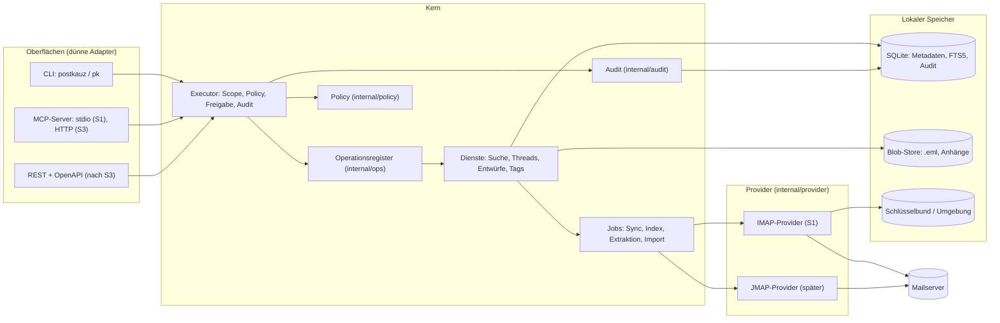

# Architektur

Stand: S1.1 (15.10.2026). Dieses Dokument beschreibt die Zielarchitektur der Schnitte S1–S3 und markiert, was das Gerüst schon enthält. Verbindlich sind die Entscheidungen in [entscheidungen.md](entscheidungen.md); wo dieses Dokument davon abweicht, gilt entscheidungen.md.

„PostKauz" ist ein Arbeitstitel. Alle Namen stehen in `internal/brand` (siehe unten, „Namen").

## 1. Ziel in einem Absatz

Ein lokal laufender E-Mail-Client **ohne GUI**, der ein vorhandenes IMAP-Postfach spiegelt, durchsuchbar macht und Menschen (CLI) sowie KI-Agenten (MCP) bedient. Agenten bekommen Scopes, Risikostufen, Trockenlauf, Freigaben und ein Audit-Log. Der MVP ist **draft-only**: Er schreibt Entwürfe in den Entwürfe-Ordner des Postfachs, versendet aber nie selbst (ADR-002).

## 2. Komponenten



In Textform: Drei Oberflächen rufen **ausschließlich** den Executor. Der Executor schlägt die Operation im Register nach, prüft Scope und Policy, schreibt den Audit-Eintrag und ruft erst dann den Handler. Handler arbeiten gegen den lokalen Speicher; alles, was den Server berührt, läuft über Jobs und das Provider-Interface.

### Paketübersicht

| Paket | Aufgabe | Stand im Gerüst |
|---|---|---|
| `cmd/postkauz` | `main`, ruft `cli.Run` | fertig |
| `internal/brand` | Name, Alias, Präfixe an einer Stelle | fertig |
| `internal/ops` | Register, Executor (mit Schwärzung je Operation), `accounts.list/add/test/remove` | S1.1 + Tests |
| `internal/policy` | Scope, Risiko R0–R3, `Check` | Stub + Tests |
| `internal/audit` | Event-Typ, Writer-Schnittstelle | Typ + Stubs (SQLite-Writer im Store) |
| `internal/store` | Migrationen mit Schema-Schutz, Konten, SQLite-Audit-Writer | S1.1 + Tests |
| `internal/config` | TOML-Konfiguration, Pfade (Konfiguration, Daten, Datenbank, Log) | S1.1 + Tests |
| `internal/secrets` | Schlüsselbund (go-keyring), Umgebung, unsicherer Testspeicher, `Secret`-Typ | S1.1 + Tests |
| `internal/imapx` | dünne Schicht über go-imap (ADR-007): Dial mit Watchdog, Login, SASL-OAuth (Entwurf), CAPABILITY, LIST | S1.1-Ausschnitt + Tests |
| `internal/oauth` | Token-Quelle mit Refresh und Sperrzeit (Entwurf P3) | Entwurf + Tests |
| `internal/provider` | `MailProvider`, `Submission` | Schnittstellen |
| `internal/provider/imap` | IMAP-Provider über `imapx`; heute nur Verbindungsprüfung (Fähigkeiten, Ordnerrollen) | S1.1-Ausschnitt + Tests |
| `internal/cli` | cobra-Adapter, Exit-Codes, `doctor` | `version`, `doctor`, `accounts list`, `account add/test/remove` |
| `internal/mcp` | MCP-Adapter | nur Plan (`doc.go`) |

Spätere Pakete (nicht angelegt): `internal/sync`, `internal/mime`, `internal/search`, `internal/blob`, `internal/importer`.

`make guard` prüft neben „kein SMTP-Code" auch, dass außer `internal/imapx` kein Paket go-imap importiert (ADR-007; Tests dürfen den Fake-Server der Bibliothek nutzen).

## 3. Zwei Wahrheiten (ADR-003)

Es gibt keine einzelne „Wahrheit". Zwei Datenbestände haben je eigene Zuständigkeit:

| Frage | Wahrheit | Folge |
|---|---|---|
| Was liegt **jetzt** im Postfach, welche Flags, welcher Ordner? | **Der Server** | Bei Konflikt gewinnt der Server (außer bei rein lokalen Tags). |
| Was habe ich je gesehen, was ist archiviert, was ist indiziert, wer hat was freigegeben, was wurde ausgelöst? | **Die lokale Datenbank** | Archiv, Index, Freigaben und Audit hängen nie vom Server ab. |

Konsequenzen, die als Regeln gelten:

1. **Server gewinnt beim Zustand.** Der nächste `Changes()`-Lauf überschreibt lokale Flags und Ordnerzuordnungen. Lokale Schreibaktionen sind „optimistisch mit Pending-Markierung", bis der Server sie bestätigt.
2. **Der Server löscht, das Archiv behält.** Verschwindet eine Nachricht serverseitig, setzt PostKauz `messages.deleted_remote_at` und behält Rohmail und Index. Eine Aufbewahrungs- oder Löschfrist ist eine eigene, ausdrückliche Operation (ab S3, Löschkonzept), nie ein Nebeneffekt des Sync.
3. **Anbieterwechsel synchronisiert das Archiv nie zurück.** Wer das Konto wechselt, legt ein neues Konto an; das alte Archiv bleibt lesbar. Es gibt keine Operation „Archiv in neues Postfach hochladen" (außer dem bewussten Export, S3).
4. **Erstabgleich und Import über Identität, nicht über Datum.** Ein Thunderbird-Import (mbox/Maildir) und der erste IMAP-Abgleich erkennen Duplikate per `Message-ID` und `content_hash`, mit Überlappung; „alles ab Datum X" ist verboten, weil es Lücken und Doppelte erzeugt.
5. **Entwürfe sind lokal-führend bis zum APPEND.** Ein Entwurf entsteht lokal (`drafts`), wird per IMAP APPEND in den Entwürfe-Ordner gelegt und dort vom Menschen weiterbearbeitet oder gesendet. Ab dem Zeitpunkt, an dem der Mensch ihn im Mailclient anfasst, ist die Serverkopie maßgeblich; PostKauz überschreibt sie nicht mehr.

## 4. Provider-Interface: JMAP-Semantik, IMAP-Abbildung

Das Interface (`internal/provider/provider.go`) ist nach JMAP geschnitten, weil JMAP Postfach, Nachricht, Zustand und Änderungen am saubersten beschreibt. IMAP wird darauf abgebildet. Ein späterer JMAP-Provider passt 1:1.

| Methode | JMAP | IMAP (S1) |
|---|---|---|
| `Capabilities()` | Session-Objekt | CAPABILITY nach Login: CONDSTORE, QRESYNC, UIDPLUS, IDLE, MOVE, SPECIAL-USE, NAMESPACE, `X-GM-EXT-1`, PERMANENTFLAGS |
| `ListMailboxes()` | `Mailbox/get` (mit `role`) | `LIST` mit SPECIAL-USE; sonst Namensheuristik je Anbieter; Namen aus IMAP-UTF-7 dekodiert |
| `Changes(mailbox, since, limit)` | `Email/changes` mit `sinceState` | siehe unten |
| `FetchHeaders()` | `Email/get` (Kopf) | `UID FETCH (FLAGS INTERNALDATE RFC822.SIZE BODY.PEEK[HEADER])` |
| `FetchRaw()` | Blob-Download | `UID FETCH BODY.PEEK[]` (streamt; `.PEEK`, damit `\Seen` unberührt bleibt) |
| `SetFlags()` | `Email/set` (keywords) | `UID STORE`; Keywords nur bei `KeywordsPermanent` |
| `Move()` | `Email/set` (mailboxIds) | `UID MOVE`, sonst `COPY` + `\Deleted`-Markierung ohne Expunge-Aufruf der Agentenseite (siehe Hinweis) |
| `Trash()` | `Email/set` → Papierkorb | `MOVE` in den Ordner mit Rolle `trash`; bei Gmail ausdrücklich „in den Papierkorb verschieben" |
| `Append()` | `Email/import` | `APPEND` mit Flags und Datum; UID über `APPENDUID` (UIDPLUS) |
| `Idle()` | EventSource/Push | `IDLE` auf INBOX; Polling für übrige Ordner |

**Kein Expunge.** Das Interface enthält absichtlich keine Operation, die Nachrichten endgültig löscht (ADR-002, Entscheidung 6). Wo IMAP ohne MOVE-Erweiterung nur `COPY` + `\Deleted` + `EXPUNGE` kennt, ist dieser Ersatz eine interne Angelegenheit des IMAP-Providers und beschränkt sich auf `UID EXPUNGE` der soeben kopierten UIDs (UIDPLUS); ohne UIDPLUS und ohne MOVE meldet der Provider `ErrUnsupported`, statt ein globales `EXPUNGE` auszuführen.

### Änderungserkennung (`Changes`)

Die Strategie folgt den erkannten Fähigkeiten (`Capabilities.SyncStrategy()`). **Hinweis (ADR-007):** `go-imap` v2 beta.8 kennt kein QRESYNC; bis zu einem Beitrag oder Fork läuft auch auf QRESYNC-fähigen Servern die Strategie `condstore` mit UID-SEARCH-Abgleich für Löschungen. Alle IMAP-Zugriffe laufen über `internal/imapx` mit Watchdog (Deadline je Kommando, Close + Reconnect mit Backoff, IDLE-Neustart alle 5 bis 10 Minuten, TCP-Keepalive).


| Strategie | Voraussetzung | Neue | Flag-Änderungen | Gelöschte |
|---|---|---|---|---|
| `qresync` | CONDSTORE + QRESYNC | UIDs ab `UIDNEXT` | `FETCH … (CHANGEDSINCE modseq)` | `VANISHED (EARLIER)` |
| `condstore` | CONDSTORE | UIDs ab `UIDNEXT` | `CHANGEDSINCE` | periodischer `UID SEARCH ALL`-Abgleich |
| `uid-scan` | nichts | UIDs ab `UIDNEXT` | Flags aller UIDs in Fenstern | periodischer `UID SEARCH ALL`-Abgleich |

- **UIDVALIDITY-Wechsel** setzt `ChangeSet.Reset`. Der Aufrufer gleicht dann den Ordner per `Message-ID`/`content_hash` neu ab (Regel 4 oben), er lädt nicht blind alles neu.
- **Erstsync in Fenstern** (`limit`, `ChangeSet.More`): resume-fähig, der neue `SyncState` wird erst **nach** erfolgreicher lokaler Verarbeitung gespeichert. Ein Absturz mitten im Fenster wiederholt das Fenster; Idempotenz entsteht über den eindeutigen Schlüssel `(mailbox_id, uid)` und `content_hash`.
- **Reconnect mit Backoff** (exponentiell, mit Obergrenze und Jitter). `ErrAuth` wird **nicht** wiederholt: ein Audit-Ereignis und ein Hinweis in `doctor`, sonst sperren Anbieter das Konto.
- **Gmail-Eigenheiten** (`GmailExtensions`): Der Ordner „Alle Nachrichten" enthält jede Nachricht ein weiteres Mal. PostKauz behandelt Labels als Ordner und dedupliziert über `Message-ID`; eine Nachricht darf in `message_mailboxes` mehrfach vorkommen, in `messages` nur einmal. Verbindungslimit (15 je Konto) beachten: ein Pool von höchstens 3–4 Verbindungen.

### Versand (`Submission`)

`internal/provider/submission.go` beschreibt den Versandweg (SMTP, später JMAP `EmailSubmission`) und trägt die Eigenschaft `SavesSentCopy()` (Gmail legt die Kopie selbst an, Dovecot nicht). Es ist im MVP **nicht implementiert und nicht verdrahtet** (ab S4).

## 5. Operationsregister und Adapter (ADR-004)

Jede fachliche Operation ist ein Eintrag **als Daten** in `internal/ops`:

```go
type Operation struct {
    Name         string       // "objekt.verb", z. B. "messages.search"
    Scope        policy.Scope // z. B. mail:search
    Risk         policy.Risk  // R0–R3
    Idempotent   bool
    InputSchema  json.RawMessage // JSON-Schema
    OutputSchema json.RawMessage
    Summary      string       // ein Satz für Hilfe und Tool-Beschreibung
    Handler      Handler
}
```

Die Oberflächen sind **dünne, ausdrücklich geschriebene Adapter** mit je einer Bindungstabelle. Es gibt keine Reflection und keinen Generator:

| Operation | CLI | MCP-Tool | REST (später) |
|---|---|---|---|
| `accounts.list` | `postkauz accounts list` | `mail_list_accounts` | `POST /v1/ops/accounts.list` |
| `messages.search` | `postkauz search` | `mail_search` | `POST /v1/ops/messages.search` |
| `drafts.create` | `postkauz draft new` / `draft reply` | `mail_create_draft` | `POST /v1/ops/drafts.create` |

Namen, Hilfetexte, Ausgabeformate und die Auswahl, was MCP überhaupt anbietet, sind Entscheidungen und stehen deshalb von Hand in den Bindungstabellen. Was der Adapter **nicht** tut: Scope prüfen, Policy auswerten, auditieren, Fachlogik. Das tut allein der Executor.

**Vertragstests** (je Operation, ab der zweiten Operation Pflicht):

1. Die Operation ist formal gültig (`Validate`: Name, Scope, Risiko, Schemas, Handler).
2. Jede Oberfläche, die sie bindet, liefert dasselbe Ein-/Ausgabeschema wie das Register.
3. Die Operation durchläuft für jeden Scope-Satz die Kette Scope → Policy → Freigabe → Audit → Handler (verweigerte Aufrufe erreichen den Handler nie und sind auditiert).
4. Der Executor ist **fail closed**: Schlägt das Schreiben des Audit-Eintrags fehl, läuft der Handler nicht (Test vorhanden).

## 6. Policy- und Audit-Kette

```mermaid
sequenceDiagram
  participant O as Oberfläche (CLI/MCP)
  participant X as Executor
  participant P as Policy
  participant A as Audit
  participant H as Handler
  O->>X: Request(Key, Operation, Input, DryRun?)
  X->>X: Register: Operation nachschlagen
  X->>P: Check(Key, Operation, DryRun)
  P-->>X: Decision (allow, deny, needs_approval; DryRun)
  X->>A: Append(Event: Ergebnis der Prüfung)
  alt allow
    X->>H: Handler(Input, DryRun)
    H-->>X: Output oder Fehler
    opt Fehler
      X->>A: Append(Event: error)
    end
    X-->>O: Result
  else deny oder needs_approval
    X-->>O: PolicyError (Exit 3 bzw. 4, MCP-Status)
  end
```

- **Reihenfolge:** Policy-Entscheid → Audit-Eintrag → Handler. Der Audit-Eintrag steht **vor** der Wirkung. Fehler im Handler erzeugen einen zweiten Eintrag (`error`).
- **Trockenlauf:** `dry_run` gilt für jede schreibende Operation. Standard je Schlüssel (`dry_run_default`), ausdrücklich überschreibbar. Der Handler bekommt `Call.DryRun` und darf dann nichts verändern.
- **`needs_approval` ist kein Fehler der Operation**, sondern ein Zustand: MCP liefert ihn als Ergebnis (nicht als `isError`), die CLI als Exit-Code 4.
- **Freigabe-Erzwingung liegt im Executor**, nicht in einer Oberfläche. Ein zweiter MCP-Server oder später REST kann sie nicht umgehen.

Stand im Gerüst: `policy.Check` ist ein Stub mit den Regeln „fehlender Scope → Deny, R0/R1 → Allow, R2 → Allow, R3 → NeedsApproval, Trockenlauf → Allow mit `DryRun`". Policy-Datei, Limits und die Freigabe-Zustandsmaschine kommen mit S2 (siehe [sicherheit.md](sicherheit.md)).

## 7. Jobs und Prozessmodell

Alles, was den Server berührt oder lange dauert, läuft als **Job** (Tabelle `jobs`, kein Redis, kein externer Broker):

| Job-Typ | Auslöser | Inhalt |
|---|---|---|
| `sync` | Intervall, IDLE-Signal, `postkauz sync`, `mail_sync_now` | `Changes()` eines Ordners, Köpfe und Rohmails holen, Blobs schreiben |
| `index` | nach `sync`/`import` | Body bereinigen, FTS-Zeilen und Wortstamm schreiben |
| `extract` | nach `sync` | Anhangstext in Subprozess mit Zeit- und Speicherlimit |
| `import` | `postkauz import mbox/maildir` | Einlesen mit Message-ID-/Hash-Abgleich |
| `export` | `postkauz export`, täglich (Audit) | mbox/EML-Verzeichnis, Audit-JSONL mit Prüfsumme |

Regeln: Jobs sind **idempotent** und wiederholbar; Sperren über `locked_by`/`locked_at` mit Ablauf; `attempts` und `last_error` für Backoff; ein Job je (Konto, Ordner) gleichzeitig.

Prozesse im MVP:

- `postkauz sync --watch` (S1): Dauerläufer im Vordergrund, führt Jobs aus, hält IDLE auf INBOX. Später als Windows-Aufgabe, systemd-Dienst oder Docker-Container.
- `postkauz mcp` (S1): kurzlebiger stdio-Prozess je Agent-Sitzung, **ohne** eigenen Sync; er liest die Datenbank und kann Jobs einreihen.
- `postkauz …` (CLI): kurzlebig.

Alle Prozesse teilen **eine SQLite-Datei** im WAL-Modus mit `busy_timeout`. Es gibt genau einen schreibenden Dauerläufer je Datenbank; die kurzlebigen Prozesse schreiben nur kurze Transaktionen (Audit, Entwürfe, Job-Einreihung). Die Datenbank darf nie in einem Cloud-synchronisierten Ordner liegen (siehe [datenmodell.md](datenmodell.md)).

## 8. Namen (Arbeitstitel)

Der Projektname ist ein Platzhalter. Umbenennen heißt: `internal/brand/brand.go`, Modulpfad in `go.mod` samt Importen (`go mod edit -module …` plus `sed`), `BINARY`/`ALIAS` im Makefile und Verzeichnis `cmd/postkauz`. Doku und Meldungen leiten sich aus `brand` ab, soweit es der Aufwand rechtfertigt; die Doku nennt „PostKauz" im Text und wird bei einer Umbenennung per Suchen/Ersetzen angepasst.
