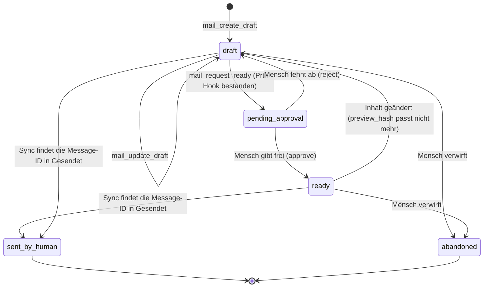

# Sicherheitsmodell

Stand: S1.1 (15.10.2026). Implementiert sind Scope-/Risikotypen, `policy.Check` (Stub), der fail-closed-Executor, die append-only-Audit-Tabelle mit SQLite-Writer, die Ablage von Zugangsdaten (Abschnitt 4) und deren Tests. Alles Übrige ist Zielentwurf für S1–S3 und als solcher gekennzeichnet. Meldeweg für Sicherheitsprobleme: [SECURITY.md](../SECURITY.md).

## 1. Schutzgüter und Annahmen

**Schutzgüter:** Inhalt der Postfächer (oft personenbezogen, teils besondere Kategorien), Zugangsdaten zu Mailservern, die Fähigkeit, in fremdem Namen zu schreiben, die Integrität des Audit-Logs.

**Annahmen:**

1. Der Betreiber vertraut dem eigenen Rechner und seinem Betriebssystem-Konto. PostKauz schützt nicht vor einem Angreifer mit denselben Rechten.
2. **Jede Mail kann Anweisungen enthalten**, und kein Filter erkennt sie zuverlässig. Der Schutz liegt deshalb **außerhalb des Modells**: in Scopes, Freigaben, Limits und Audit.
3. Agenten sind **nicht vertrauenswürdig**, sondern begrenzt berechtigte Gehilfen. Was sie nicht dürfen, verhindert der Executor, nicht eine Bitte im Prompt.
4. PostKauz selbst überträgt keine Daten an Dritte. Was an ein Sprachmodell geht, entscheidet der Agent, den der Betreiber anschließt (siehe Abschnitt 9).

## 2. Scopes und Rollen

Scopes sind Zeichenketten je API-Schlüssel (`internal/policy`). Es gibt bewusst **kein `mail:send`** und keine Regel-Scopes im MVP.

| Scope | Erlaubt | Risiko der damit erreichbaren Operationen |
|---|---|---|
| `mail:read` | Köpfe, Bodies, Anhänge lesen, Ordner und Konten listen | R0 |
| `mail:search` | nur Suche und Köpfe/Snippets, **keine Bodies** (für Triage-Agenten) | R0 |
| `mail:draft` | Entwürfe anlegen, ändern, zur Prüfung vorlegen | R1/R2 |
| `mail:tag` | lokale Tags und Flags (gelesen/markiert) | R1/R2 |
| `mail:move` | Verschieben, Archivieren | R2 |
| `mail:trash` | in den Papierkorb (nie endgültig) | R3 |
| `mail:sync` | Sync anstoßen | R1 |
| `mail:export` | Anhänge in das Exportverzeichnis schreiben | R1 |
| `audit:read` | Audit-Log lesen | R0 |
| `admin` | Konten, Schlüssel, Policy verwalten. **Ersetzt keine Mail-Scopes.** | – |

**Rollen** bündeln Scopes (`policy.Roles`, getestet): `reader` (read, search, audit:read) · `assistant` (reader + draft, tag, sync) · `operator` (assistant + move, trash, export) · `admin` (operator + admin). Agenten bekommen standardmäßig `assistant`; `operator` nur bewusst.

**Risikostufen:** R0 lesen · R1 lokal ändern · R2 serverseitig ändern, reversibel · R3 extern wirksam oder schwer umkehrbar. Ein höheres Risiko verlangt strengere Kontrolle: `policy.Check` liefert für R3 ohne Trockenlauf `needs_approval`.

## 3. API-Schlüssel

- **Je Agent oder Client ein Schlüssel**, mit Ablauf, optional `revoked_at`, `last_used_at` und `dry_run_default` (Standard: an).
- **Erzeugung:** 256 Bit aus dem Zufallsgenerator des Betriebssystems; **gespeichert wird nur der SHA-256-Hash**, der Klartext erscheint genau einmal. Vergleich in konstanter Zeit. (Argon2 o. Ä. ist für hochentropische Zufallsschlüssel nicht nötig.)
- **Übergabe an den stdio-Server** per Umgebungsvariable (`POSTKAUZ_KEY`) oder Datei mit Rechten 600, **nie** als Kommandozeilenargument (sichtbar in der Prozessliste).
- **Die Tool-Liste folgt dem Schlüssel** (siehe [mcp.md](mcp.md)).
- **Verengen, nie erweitern:** Eine schlüsselspezifische Policy darf die Standardrichtlinie nur einschränken.
- HTTP-MCP (S3): nur eigene Schlüssel bzw. eigene OAuth-2.1-Token, **kein Durchreichen** fremder Token.

## 4. Zugangsdaten (Credentials)

- **Erste Wahl: Schlüsselbund des Betriebssystems** über `github.com/zalando/go-keyring` (Windows Credential Manager, macOS Keychain, Secret Service; Dienstname `postkauz`, Eintrag `account/<name>`). Die Konfigurationsdatei und die Datenbank enthalten nur `credential_ref`. Jeder Zugriff hat eine Zeitgrenze (10 s), damit ein hängender D-Bus die CLI nicht blockiert. *(umgesetzt S1.1, `internal/secrets`)*
- **Fallback für Server und Docker:** Umgebungsvariable `POSTKAUZ_PASSWORD_<NAME>`; sie wird immer zuerst gelesen und nie gespeichert (`account add --password-from-env`). *(umgesetzt S1.1)* Gemountete Secret-Dateien und eine verschlüsselte Datei mit Passphrase (AES-GCM) sind erst bei Bedarf geplant.
- **Kein stiller Rückfall:** Fehlt der Schlüsselbund (z. B. Linux ohne Secret Service, Container), scheitert das Speichern mit einem Hinweis auf die Umgebungsvariable; `doctor` meldet `keyring: unavailable`. Getestet (Prüfpunkt P4) mit simuliertem D-Bus-Fehler, simulierter Zeitüberschreitung und dem echten Schlüsselbund des Testrechners (nur lesend).
- **Nur für Testserver: `secrets.backend = "insecure-file"`.** AES-256-GCM-Datei im Datenverzeichnis (`insecure-secrets/`, Dateien 0600, Verzeichnis 0700), der Schlüssel liegt **daneben**. Das verhindert nur, dass der Klartext in Kopien der Datenbank, grep-Treffern oder Backups ohne Schlüsseldatei auftaucht; gegen jemanden mit Dateizugriff schützt es nicht. Nur ausdrücklich wählbar, `doctor` warnt. Für echte Postfächer nicht verwenden.
- **Geheimnisse im Code:** Der Typ `secrets.Secret` schwärzt sich bei jeder Formatierung (fmt, JSON, slog) zu `[redacted]`; Klartext nur über `Reveal()` an der Stelle, die ihn an den Server gibt. Operationen bekommen ihn getrennt von der Eingabe (`Call.Secret`), deshalb steht er nie im Audit. Serverfehler werden vor der Ausgabe nach dem Passwort durchsucht und geschwärzt.
- **Nie** im Repository, in Logs, im Audit, in Fehlermeldungen oder in `--json`-Ausgaben. Tests mit Kanarienwerten prüfen das: S1.1 für `account add/test/list/remove` und `doctor` (Datenbank samt WAL, Log, Audit, stdout/stderr, beide Speicher, Passwort geht über eine echte IMAP-Anmeldung an einen Testserver im Prozess); MCP-Ausgaben folgen mit S1.9.
- **OAuth2-Token** (ab S1, „bring your own client": Client-ID/Secret des Nutzers, Loopback- oder Device-Code-Flow; keine eigene verifizierte Google-App) werden wie Passwörter behandelt. Ein Refresh-Fehler erzeugt ein Audit-Ereignis und einen Hinweis, keine Endlosschleife. *Stand S1.1 (Prüfpunkt P3, Entwurf):* SASL XOAUTH2 (eigene Umsetzung) und OAUTHBEARER (go-sasl) in `internal/imapx`, eine erneuernde Token-Quelle mit Sperrzeit nach Fehlern in `internal/oauth`, beides gegen einen Fake-Server bzw. Fake-Refresher getestet. Kontenanlage mit `auth_type = oauth2` ist noch gesperrt; Autorisierungs-Flow und Token-Endpunkt fehlen.
- `postkauz doctor` meldet seit S1.1 die Erreichbarkeit des Schlüsselbunds und je Konto, ob ein Passwort hinterlegt ist. `doctor --secrets` (Dateirechte prüfen, Kanarienwerte in Logs suchen) folgt in S1.11.

## 5. Freigabe-Zustände (MVP: draft-only)

Im MVP **sendet PostKauz nie**. Ein Entwurf wird mit korrekten `Message-ID`/`In-Reply-To`/`References` per IMAP APPEND in den Entwürfe-Ordner gelegt; der Mensch sendet im gewohnten Mailclient.



- **`ready`** heißt: Ein Mensch hat genau diesen Inhalt (Empfänger, Betreff, Body, Anhang-Hashes) gesehen und freigegeben. `preview_hash` bindet die Freigabe an diesen Inhalt; **jede Änderung macht sie ungültig** und führt zurück nach `draft`.
- **Prüf-Hook:** Vor `pending_approval` kann ein konfigurierbarer Hook (externes Kommando, z. B. ein Linter für Stil und Pflichtangaben) laufen; scheitert er, bleibt der Entwurf `draft`.
- **Wer freigibt:** nur ein Mensch, über die CLI (`postkauz approve`) oder später REST. Ein Agenten-Schlüssel kann `pending_approval` auslösen, aber nie `ready` setzen. Jeder Übergang wird mit Akteur auditiert.
- **Erkennung des Versands:** Beim Sync des Ordners „Gesendet" gleicht PostKauz die `Message-ID` mit `drafts.message_id_header` ab und setzt `sent_by_human`. **Risiko:** Manche Clients (Webmail, Thunderbird) vergeben beim Senden unter Umständen eine neue `Message-ID`. Der Abgleich hat deshalb einen Rückfall (Empfänger + Betreff + Body-Hash + Zeitfenster; entschieden 14.10.2026). Findet auch er nichts, bleibt der Entwurf `ready`, bis der Mensch ihn abschließt. Das tatsächliche Verhalten je Client wird in S2 gemessen und hier dokumentiert.
- **Freigaben verfallen** nach einer konfigurierbaren Zeit (Standard 7 Tage).
- Dasselbe Muster („Antrag → Freigabe → Ausführung, nie: der Agent tut es") gilt für alle künftigen R3-Aktionen.

**Policy-Datei (S2)**, TOML, je Schlüssel nur verengbar:

```toml
[draft]
require_approval_for_ready = true
check_hook = ""                  # optional: Kommando; Exit 0 = bestanden

[delete]
agent_may = "trash_only"         # none | trash_only   (endgültiges Löschen gibt es für Agenten nie)

[move]
agent_may = "within_account"     # none | archive_only | within_account
bulk_confirm_threshold = 50      # darüber: confirm_count mit exakter Anzahl

[agent_defaults]
dry_run_default = true
max_chars = 20000
```

Regeln werden von Agenten **nur vorgeschlagen** (deaktiviert angelegt, ab S4); aktivieren kann sie nur ein Mensch.

## 6. Audit

- **Append-only-Tabelle** `audit_events`; Trigger blockieren `UPDATE` und `DELETE` (getestet). Der Executor schreibt den Eintrag **vor** dem Handler und bricht ab, wenn das Schreiben scheitert (fail closed, getestet).
- **Inhalt:** Zeit, Akteurtyp (`human`\|`agent`\|`system`), Schlüssel, Scope, Operation, Parameter **ohne Inhalte** (IDs, Feldnamen, Zähler, Hashes), Ziele, Ergebnis (`ok`\|`denied`\|`needs_approval`\|`error`), Grund, Trockenlauf, Dauer. **Mailtexte stehen nie im Audit** (Datenminimierung). Auch Systemereignisse (Sync-Läufe, Token-Refresh, Konfigurationsänderungen) werden erfasst.
- **Täglicher Export mit Prüfsumme** an einen **zweiten Ort** (anderer Datenträger oder Rechner; Eintrag in `audit_exports`). Das ist der eigentliche Manipulationsschutz: Wer nur die Datenbankdatei ändert, ändert den Export nicht. `postkauz audit verify` (S1) vergleicht Datenbankzeilen mit den exportierten Dateien und deren Prüfsummen.
- **Ehrlich:** Wer Schreibrechte auf Datenbank **und** zweiten Ort hat, kann das Log verfälschen. Das Audit belegt das Verhalten der Agenten, nicht die Redlichkeit des Betreibers.
- **Aufbewahrung** konfigurierbar (Standard ein Jahr); Rotation per Export, nie durch Löschen einzelner Zeilen. Eine Prune-Operation ist nicht Teil des MVP.

## 7. Anhänge, HTML, Links

- **HTML wird nie gerendert.** Es wird mit einer Allowlist zu Text bereinigt (keine Skripte, Styles, Formulare). Versteckter Text (`display:none`, `font-size:0`, weiß auf weiß) wird entfernt und als „versteckter Text vorhanden" gemeldet, denn genau damit funktionieren Injektionen in Zusammenfassungen.
- **Keine Remote-Inhalte:** nichts wird nachgeladen (Tracking-Pixel, externe Bilder, Stylesheets).
- **Links** stehen getrennt mit sichtbarem Text, Ziel und Domain, mit Punycode-/Homoglyph-Warnung; `mailto:` und `javascript:` werden entfernt.
- **Anhänge:** Speicherung nur mit SHA-256; der Typ kommt aus den **Magic Bytes**, nicht aus der Dateiendung; Textextraktion in einem **Subprozess mit Zeit- und Speicherlimit**; Archive werden nicht entpackt (Zip-Bomben), Office-Makros nicht ausgeführt, Größenlimit. `mail_save_attachment` schreibt nur in das Exportverzeichnis; ausführbare Typen erhalten die Endung `.blocked`.
- **Optional:** Scan-Hook (z. B. ClamAV) vor der Extraktion; Quarantäne-Markierung statt Löschen.
- **Absenderprüfung:** `Authentication-Results` (SPF/DKIM/DMARC) werden als `auth` in der Untrusted-Hülle mitgeliefert.

## 8. Prompt Injection

Grundannahme: Mailtext ist feindliche Eingabe. Gegenmaßnahmen, nach Wirksamkeit geordnet:

1. **Rule of Two als Architekturregel.** Ein Agentenlauf soll höchstens zwei von drei Eigenschaften haben: unvertrauenswürdige Eingabe verarbeiten · auf sensible Daten zugreifen · nach außen wirken. PostKauz erzwingt das über Schlüssel: Ein Schlüssel, der Mails liest, kann im MVP **gar nicht senden**; Wirkungen nach außen entstehen nur durch den Menschen im Mailclient.
2. **Fähigkeiten statt Vertrauen.** Schreibende Operationen akzeptieren als Ziele nur IDs, die derselbe Schlüssel zuvor gelesen hat; Empfänger in Entwürfen können nicht aus einem beliebigen Mailtext übernommen werden, sondern stammen aus dem Thread, auf den geantwortet wird, oder werden vom Menschen bestätigt. *Umsetzung noch offen, Entwurf in S2; bis dahin gilt nur die Freigabe vor `ready`.*
3. **Daten statt Anweisungen.** Untrusted-Hülle, getrennte Felder, bereinigtes HTML, Link-Liste (siehe [mcp.md](mcp.md)).
4. **Schwellen und Zähler.** Massenaktionen brauchen `confirm_count`; Limits je Schlüssel und Stunde; Anomalie-Hinweis im Audit (z. B. erster Entwurf an eine neue Domain).
5. **MCP-Hygiene.** Statische, versionierte Tool-Definitionen; kein Token-Durchreichen; stdio-Server mit minimalen Rechten; REST und HTTP-MCP nur auf localhost oder mit TLS, Schlüssel und ausdrücklicher Konfiguration.
6. **Beobachtbarkeit.** Jede Aktion ist im Audit rekonstruierbar, Entwürfe sind vor `ready` sichtbar, der Mensch sendet bewusst selbst.

**Restrisiko, ehrlich benannt:** Lesen bleibt ein Risiko. Wenn ein Agent mit Mailzugriff gleichzeitig Netzzugang hat, kann er Inhalte über Links oder andere Werkzeuge nach außen tragen; das kann PostKauz nicht verhindern. Empfehlung für Agenten mit Internetzugang: `mail:search` plus threadweises Lesen statt Vollzugriff, kurze Schlüssel-Laufzeiten, kein `operator`.

## 9. Datenschutz in einem Satz je Punkt

*(Keine Rechtsberatung.)* Wer PostKauz betreibt, ist für die Verarbeitung der Korrespondenz verantwortlich; ein angeschlossener KI-Anbieter ist Auftragsverarbeiter nur mit Vertrag. Postfächer enthalten regelmäßig besondere Kategorien personenbezogener Daten, daher Datenminimierung: Auszüge statt Postfach (`max_chars`, threadweise), keine Anhänge ohne Anlass, keine Inhalte im Audit, Embeddings nur lokal oder gar nicht. Ein Löschkonzept muss Blob, Index, Exporte und Backups erfassen (S3). Die Dokumentation führt einen Abschnitt „Was verlässt den Rechner" (ab S1): PostKauz selbst nichts, der angeschlossene Agent alles, was er liest.

## 10. Betriebssicherheit

- **Netz:** Standardmäßig lauscht nichts außer stdio. Ein späterer HTTP-Port bindet an localhost oder an eine private Schnittstelle (z. B. VPN); nie ungeschützt ins Internet.
- **Dateirechte:** Datenverzeichnis nur für den Nutzer lesbar (0700), Datenbank und Log 0600 (umgesetzt S1.1; unter Windows gelten die Rechte des Profilordners); Schlüsseldateien 600.
- **Klartext-IMAP und unbestätigte Zertifikate** nur mit `--insecure-test-server` und nur für Hosts auf dem eigenen Rechner; `internal/imapx` prüft das ein zweites Mal.
- **Lieferkette:** wenige, bewusst gewählte Abhängigkeiten; `go.sum` committen; Abhängigkeiten per Dependabot beobachten; Builds reproduzierbar (`-trimpath`, feste Go-Version); Release-Artefakte mit Prüfsummen (und später Signaturen).
- **Backups enthalten Mail** und müssen verschlüsselt sein (S3).
- **Testserver** (`deploy/testmail`) sind nur für localhost gedacht und tragen Standard-Zugangsdaten: **nie im Internet betreiben**.
